# Братилов Захар, группа ИТ-1,2. Лабораторная работа №2

Вариант 3. Выполнены задачи 1.3, 2.2, 2.3, 3.3, 4.5, 4.6 и 5.2. Номера 1–5 в меню объединяют задачи по разделам. Решение использует один проект .NET 10 и одну точку входа Program.Main.

Класс, представляющий ФИО, назван PersonFullName. Любая отдельная часть ФИО может отсутствовать, но хотя бы одна часть должна быть задана. Общие классы повторно используются в разных заданиях. Меню, примеры и сценарии ручного ввода собраны в одном классе Lab2. Автосвойства, LINQ и лямбда-операторы не используются.

Снимки показывают результаты интерактивных запусков: выбранный номер виден в строке ввода. После просмотра результата Enter возвращает в меню с очисткой экрана.

Для ручного ввода выберите пункт 6 в меню ЛР2, затем тип объекта. Введённые значения видны в строках приглашений. Снимки представляют текст экрана реальных сеансов в псевдотерминале; журналы сохранены в screenshots/logs. Общая проверка формата целых чисел показана на примере роста в задаче 2.2, а допустимые диапазоны — у соответствующих заданий.

# Задание 1. Создание сущностей

## Задача 1.3. Имена

### Текст задачи

Создать сущность Имя с фамилией, личным именем и отчеством. Строковое представление должно содержать заданные части в порядке «Фамилия Имя Отчество», без лишних пробелов. Создать имена: Клеопатра; Пушкин Александр Сергеевич; Маяковский Владимир.

### Алгоритм решения

PersonFullName хранит три части ФИО в отдельных полях с явно реализованными свойствами. OptionalText удаляет пробелы по краям и заменяет пустую строку на null для каждой части ФИО. ToString объединяет заданные части одним пробелом. ValidateParts запрещает полностью пустое ФИО при создании и при изменении свойств. Если изменение недопустимо, прежнее значение сохраняется.

```csharp
public override string ToString()
{
    string result = _secondName ?? string.Empty;

    if (_name is not null)
    {
        result += result.Length > 0 ? " " + _name : _name;
    }

    if (_patronymic is not null)
    {
        result += result.Length > 0 ? " " + _patronymic : _patronymic;
    }

    return result;
}
```

```csharp
private static string? OptionalText(string? value)
{
    string? result = value?.Trim();
    return string.IsNullOrEmpty(result) ? null : result;
}
```

```csharp
private static void ValidateParts(string? name, string? secondName, string? patronymic)
{
    if (name is null && secondName is null && patronymic is null)
    {
        throw new ArgumentException("Должна быть задана хотя бы одна часть ФИО.");
    }
}
```

### Тестирование

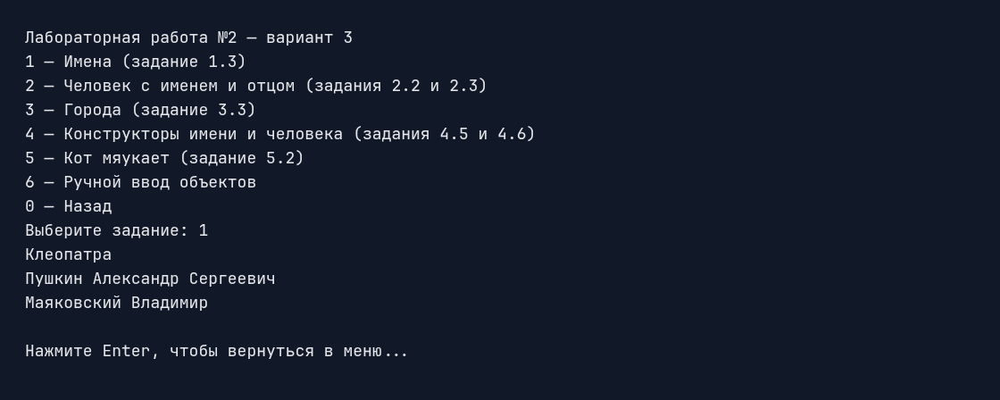

### Проверка ручного ввода

В меню ЛР2 выберите 6 → 1. Можно пропустить любую отдельную часть ФИО, но хотя бы одну необходимо заполнить. Ниже показаны корректные варианты и отклонение полностью пустого ФИО.

#### ФИО: только имя

Задания 1.3 и 4.5. Фамилия и отчество пропущены.

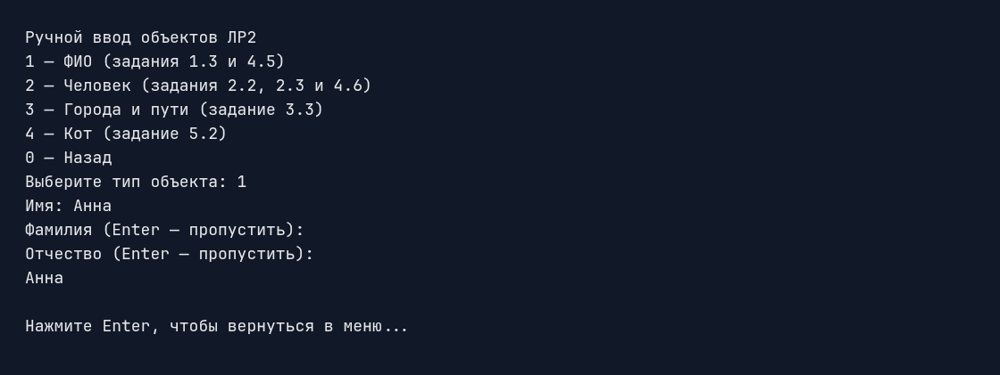

#### ФИО: все части

Задания 1.3 и 4.5. Пробелы по краям удаляются.

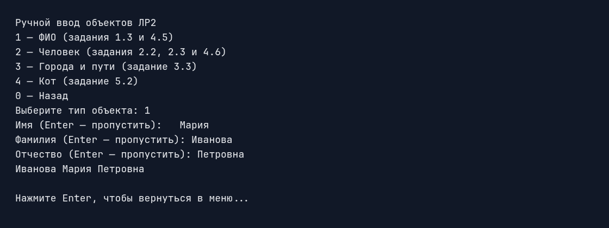

#### ФИО: только фамилия

Личное имя и отчество отсутствуют. При выводе нет лишних пробелов.

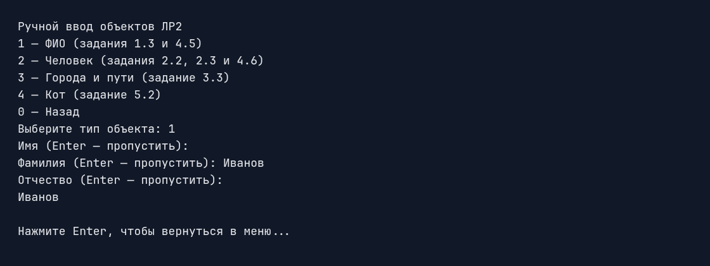

#### ФИО: только отчество

Личное имя задано пробелами и считается отсутствующим. Выводится только отчество.

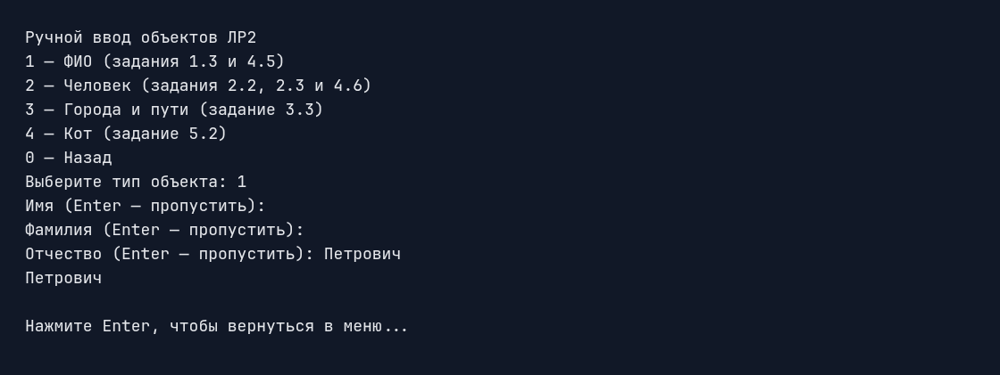

#### Полностью пустое ФИО

Если все части пропущены или состоят из пробелов, ввод ФИО повторяется. После исправления принимается одна фамилия.

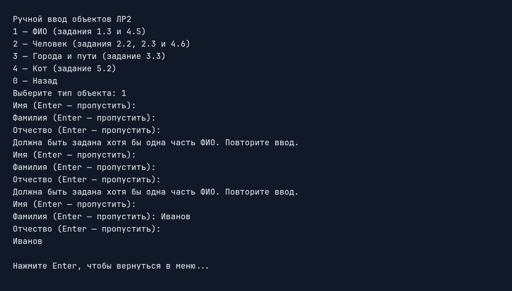

# Задание 2. Взаимодействие объектов

## Задача 2.2. Человек с именем

### Текст задачи

Объединить сущности Человек и Имя так, чтобы имя человека задавалось объектом. Создать Клеопатру ростом 152, Пушкина Александра Сергеевича ростом 167 и Маяковского Владимира ростом 189.

### Алгоритм решения

Person хранит ссылку на PersonFullName в свойстве FullName и положительный целочисленный рост в Height. При выводе вызывается ToString объекта ФИО. Конструктор отклоняет null вместо объекта имени, а свойство Height — неположительный рост.

```csharp
public Person(PersonFullName fullName, int height, Person? father)
{
    _fullName = fullName ?? throw new ArgumentNullException(nameof(fullName));
    Height = height;
    Father = father;
    CompleteNameFromFather();
}
```

```csharp
public override string ToString()
{
    CompleteNameFromFather();

    return $"{_fullName}, рост: {_height}";
}
```

### Тестирование

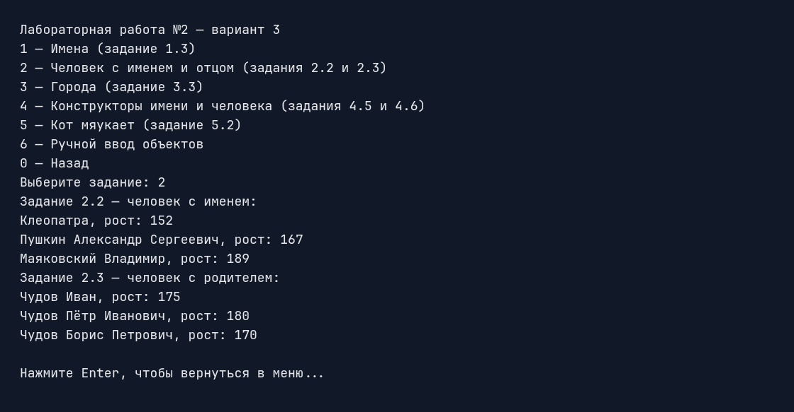

### Проверка ручного ввода

В меню ЛР2 выберите 6 → 2. Проверяются способ задания имени и положительный целочисленный рост. Пример с объектом ФИО и отцом приведён в пункте 2.3.

#### Человек: строковое имя без отца

Задания 2.2 и 4.6. Создание человека по имени и росту.

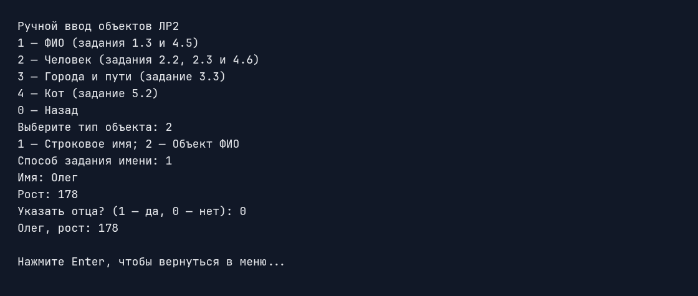

#### Ошибки ввода человека

Проверены неверный способ задания имени (0 и 3), пустое строковое имя, рост: буквы, дробь, пустая строка, переполнение Int32, ноль и отрицательное значение; неверный ответ о наличии отца (−1 и 2). После исправления создаётся человек.

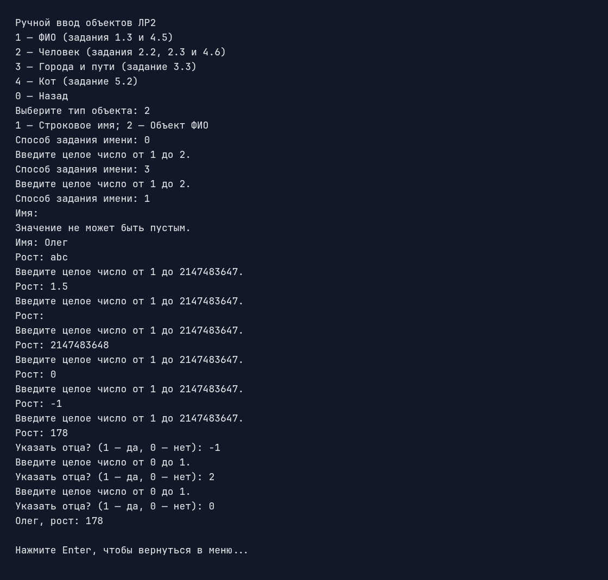

## Задача 2.3. Человек с родителем

### Текст задачи

Добавить отца, который также является объектом Человек. При приведении к строке дополнить отсутствующую фамилию фамилией отца, а отчество — на основании его имени. Создать Чудова Ивана, Чудова Петра и Бориса; назначить Ивана отцом Петра, а Петра отцом Бориса; вывести всех троих.

### Алгоритм решения

Свойство Father хранит ссылку на непосредственного отца. CompleteNameFromFather вызывается в основном конструкторе и при приведении человека к строке. Если отец отсутствует, метод завершается. Заполняются только отсутствующие фамилия и отчество. Если личное имя отца отсутствует, отчество не формируется. Сеттер Father запрещает назначить человека собственным отцом. Цепочка предков не обходится. Для примеров отдельно обработаны Лев, Пётр и имена на «й»; для остальных добавляется «ович». Это не полный набор правил русского языка. Рост этих трёх людей в условии не задан, поэтому выбраны 175, 180 и 170.

```csharp
private void CompleteNameFromFather()
{
    if (_father is null)
    {
        return;
    }

    if (_fullName.SecondName is null)
    {
        _fullName.SecondName = _father.FullName.SecondName;
    }

    string? fatherName = _father.FullName.Name;

    if (_fullName.Patronymic is null && fatherName is not null)
    {
        _fullName.Patronymic = MakePatronymic(fatherName);
    }
}
```

```csharp
private static string MakePatronymic(string name)
{
    if (string.Equals(name, "Лев", StringComparison.OrdinalIgnoreCase))
    {
        return "Львович";
    }

    if (string.Equals(name, "Пётр", StringComparison.OrdinalIgnoreCase) ||
        string.Equals(name, "Петр", StringComparison.OrdinalIgnoreCase))
    {
        return "Петрович";
    }

    if (name.EndsWith('й'))
    {
        return name[..^1] + "евич";
    }

    return name + "ович";
}
```

### Тестирование


### Проверка ручного ввода

В меню ЛР2 выберите 6 → 2 и укажите наличие отца. Проверяются рост отца и заполнение недостающих частей ФИО.

#### Человек: ФИО и отец

Задания 2.2, 2.3 и 4.6. Фамилия и отчество дополняются по отцу.

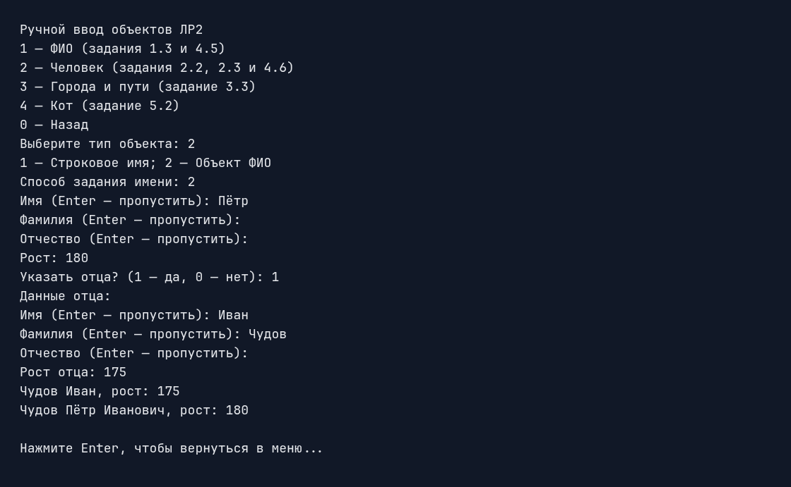

#### Отец без личного имени

Фамилия наследуется от отца. Отчество не создаётся, поскольку личное имя отца отсутствует.

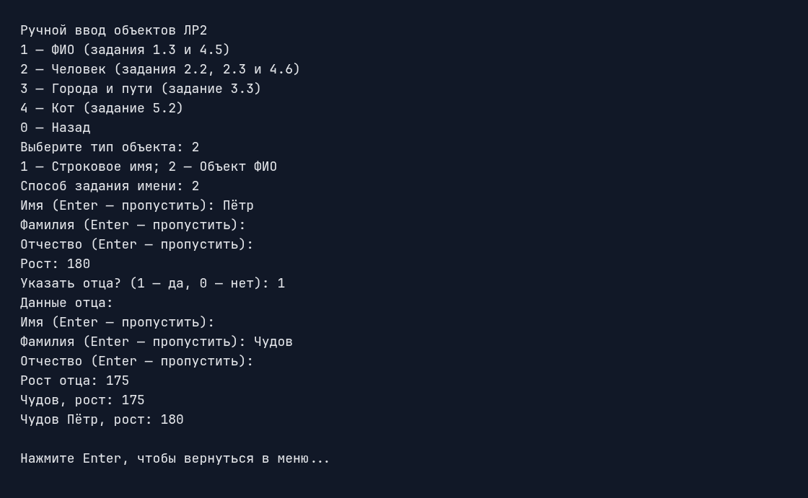

#### Ошибки роста отца

Проверены нулевой и отрицательный рост отца. У человека задана фамилия; отчество дополняется по имени отца.

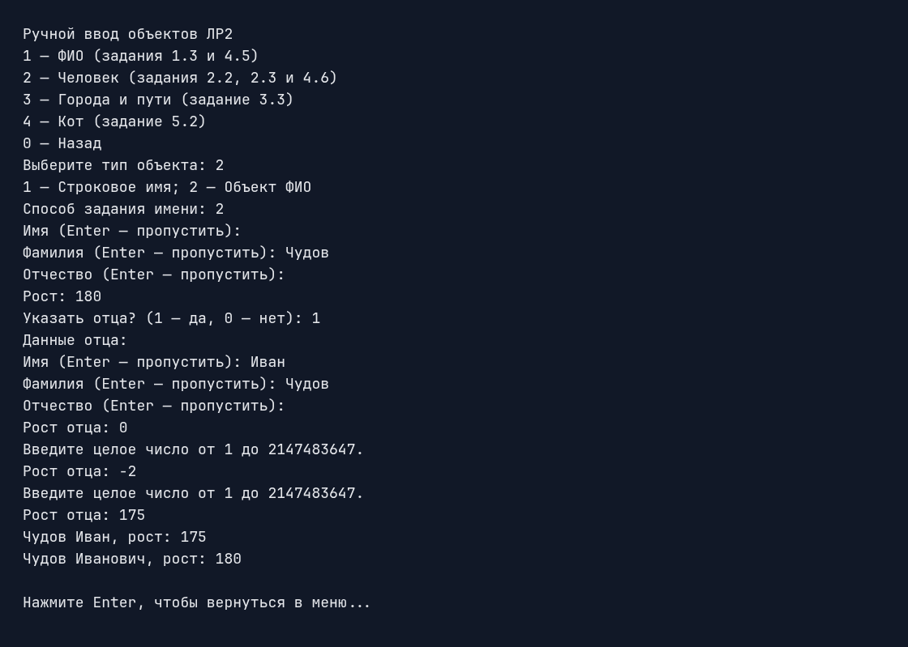

# Задание 3. Наборы объектов

## Задача 3.3. Города

### Текст задачи

Создать сущность Город с названием и набором путей. Каждый путь содержит другой город и стоимость поездки. Строковая форма должна показывать название города и пары «название:стоимость». Построить схему с рисунка 2 исходного задания.

### Алгоритм решения

City хранит название и список Route. Каждый Route содержит ссылку на город назначения и положительную стоимость. Город назначения пути нельзя заменить после создания, поэтому проверки City.AddRoute нельзя обойти изменением ссылки. AddRoute проверяет отсутствие null, пути в себя и повторного назначения. Для двусторонних связей добавляются два пути. Схема содержит шесть городов и двенадцать направленных путей: A→B:5, A→F:1, A→D:6, B→A:5, B→C:3, C→B:3, C→D:4, D→A:6, D→C:4, D→E:2, F→B:1, F→E:2. У города E исходящих путей нет.

```csharp
public void AddRoute(City destination, int cost)
{
    if (destination is null)
    {
        throw new ArgumentNullException(nameof(destination));
    }

    if (ReferenceEquals(this, destination))
    {
        throw new ArgumentException("Путь должен вести в другой город.", nameof(destination));
    }

    for (int i = 0; i < _routes.Count; i++)
    {
        if (ReferenceEquals(_routes[i].Destination, destination))
        {
            throw new ArgumentException("Путь в этот город уже существует.", nameof(destination));
        }
    }

    _routes.Add(new Route(destination, cost));
}
```

```csharp
private static City[] CreateCities()
{
    City a = new City("A");
    City b = new City("B");
    City c = new City("C");
    City d = new City("D");
    City e = new City("E");
    City f = new City("F");

    // Ориентированные пути с рисунка 2; обратный путь добавляется отдельно.
    a.AddRoute(b, 5);
    a.AddRoute(f, 1);
    a.AddRoute(d, 6);

    b.AddRoute(a, 5);
    b.AddRoute(c, 3);

    c.AddRoute(b, 3);
    c.AddRoute(d, 4);

    d.AddRoute(a, 6);
    d.AddRoute(c, 4);
    d.AddRoute(e, 2);

    f.AddRoute(b, 1);
    f.AddRoute(e, 2);

    return new[] { a, b, c, d, e, f };
}
```

### Тестирование

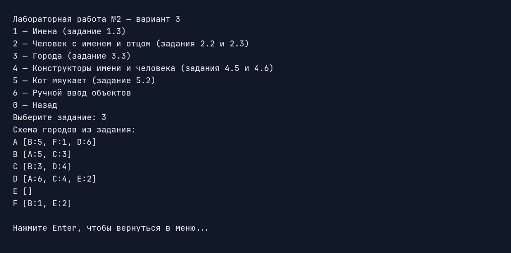

### Проверка ручного ввода

В меню ЛР2 выберите 6 → 3. Проверяются количество и названия городов, количество путей, номер назначения и стоимость поездки.

#### Город без путей

Задание 3.3. Один город, исходящих путей нет.

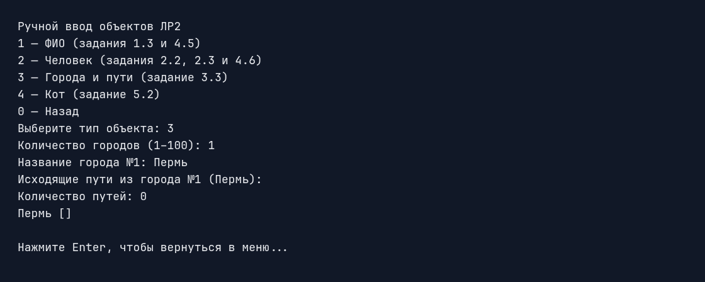

#### Города с путями

Задание 3.3. Два города и два направленных пути с разными стоимостями.

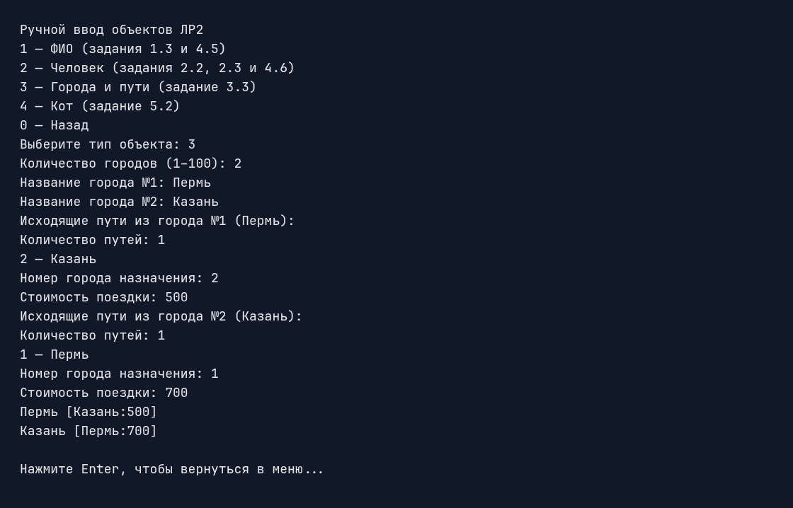

#### Количество и названия городов

Отклоняются количество городов вне диапазона 1–100 и пустое название. Для одного города допустимо только ноль путей.

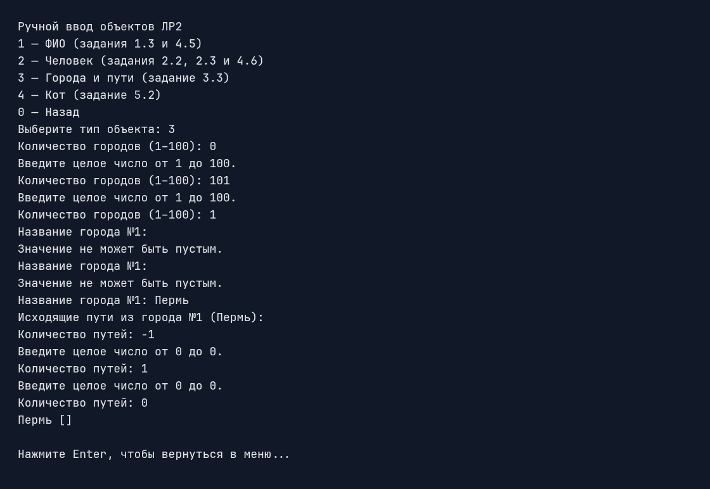

#### Ошибки путей между городами

Отклоняются количество путей вне диапазона, несуществующий номер города, путь в себя, неположительная стоимость и повторный путь. После исправления сохранены два разных направления.

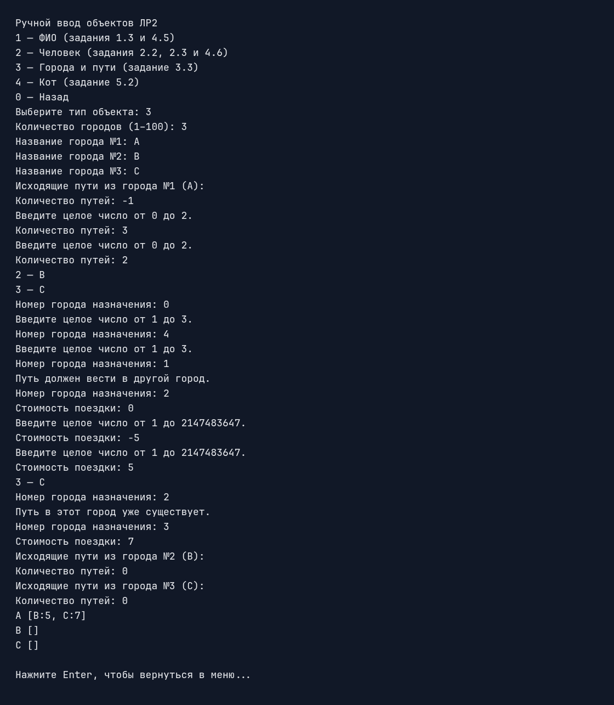

# Задание 4. Конструкторы

## Задача 4.5. Создаем имена

### Текст задачи

Предусмотреть создание имени по личному имени, по личному имени и фамилии, либо по всем трём частям. Создать имена Клеопатры, Александра Сергеевича Пушкина, Владимира Маяковского и Христофора Бонифатьевича. У Христофора слово «Бонифатьевич» является фамилией.

### Алгоритм решения

Конструкторы PersonFullName с одним и двумя параметрами делегируют инициализацию конструктору с тремя параметрами. Пропущенные части передаются как null. Порядок строкового представления сохраняется: фамилия, личное имя, отчество; поэтому последний пример выводится как «Бонифатьевич Христофор».

```csharp
public PersonFullName(string? name, string? secondName, string? patronymic)
{
    _name = OptionalText(name);
    _secondName = OptionalText(secondName);
    _patronymic = OptionalText(patronymic);
    ValidateParts(_name, _secondName, _patronymic);
}

public PersonFullName(string? name, string? secondName) : this(name, secondName, null)
{
}

public PersonFullName(string? name) : this(name, null, null)
{
}
```

### Тестирование

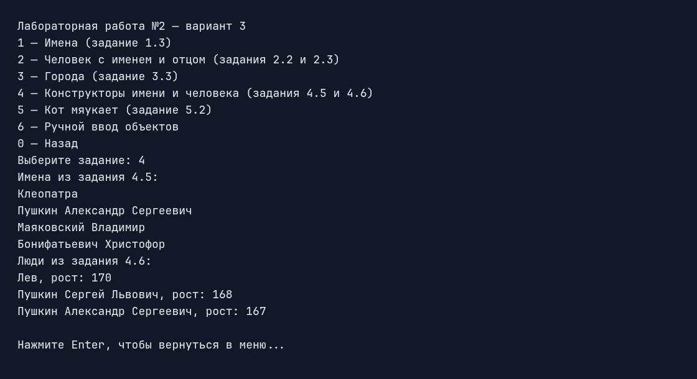

### Проверка ручного ввода

Ручной ввод ФИО вызывает конструктор с одним, двумя или тремя параметрами в зависимости от заполненных частей. Снимки корректного ввода и пропуска частей ФИО приведены в подпункте «Проверка ручного ввода» задачи 1.3.

## Задача 4.6. Создаем человека

### Текст задачи

Предусмотреть четыре способа создания человека: строковое имя и рост; строковое имя, рост и отец; объект имени и рост; объект имени, рост и отец. Фамилия и отчество должны дополняться по отцу, если не заданы. Присвоения сосредоточить в одном конструкторе. Создать Льва ростом 170, Сергея Пушкина ростом 168 с отцом Львом и Александра ростом 167 с отцом Сергеем.

### Алгоритм решения

Строковое имя преобразуется в PersonFullName, после чего все перегрузки вызывают основной конструктор. Он сохраняет ФИО, рост и ссылку на отца, затем дополняет отсутствующие части ФИО. Объект ФИО сохраняется по ссылке. Недостающие части имени дополняются от отца при создании объекта и при вызове ToString; для Льва получается «Львович», для Сергея — «Сергеевич». Общий формат вывода Person: «ФИО, рост: значение».

```csharp
public Person(PersonFullName fullName, int height, Person? father)
{
    _fullName = fullName ?? throw new ArgumentNullException(nameof(fullName));
    Height = height;
    Father = father;
    CompleteNameFromFather();
}

public Person(string? name, int height, Person father)
    : this(new PersonFullName(name), height, father)
{
}

public Person(PersonFullName fullName, int height) : this(fullName, height, null)
{
}

public Person(string? name, int height) : this(new PersonFullName(name), height, null)
{
}
```

### Тестирование


### Проверка ручного ввода

Выбор строкового имени или объекта ФИО, а также наличия отца определяет вызываемый конструктор. Снимки ввода человека и проверки роста приведены в подпунктах «Проверка ручного ввода» задач 2.2 и 2.3.

# Задание 5. Методы объектов

## Задача 5.2. Кот мяукает

### Текст задачи

Создать кота с обязательным именем. Строковая форма: «кот: Имя». Метод без параметров выводит «Имя: мяу!», метод с параметром N — N мяуканий через дефис. Создать Барсика и вызвать одно и три мяуканья.

### Алгоритм решения

Cat проверяет имя при создании. Meow() вызывает Meow(1). Перегрузка с числом повторений строит строку через StringBuilder, добавляя дефис перед каждым повторением, кроме первого. В реализации принято ограничение от 1 до 100 мяуканий; недопустимое значение вызывает ArgumentOutOfRangeException.

```csharp
public void Meow()
{
    Meow(1);
}
```

```csharp
public void Meow(int count)
{
    if (count < 1 || count > 100)
    {
        throw new ArgumentOutOfRangeException(nameof(count), "Количество должно быть от 1 до 100.");
    }

    StringBuilder sound = new StringBuilder(_name + ": ");

    for (int i = 0; i < count; i++)
    {
        if (i > 0)
        {
            sound.Append('-');
        }

        sound.Append("мяу");
    }

    sound.Append('!');

    Console.WriteLine(sound);
}
```

### Тестирование

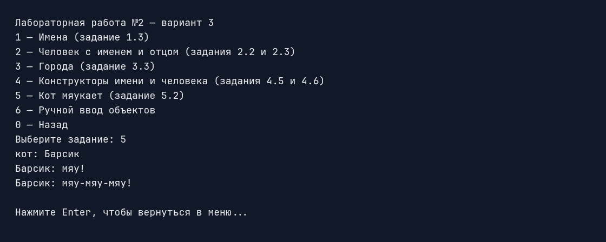

### Проверка ручного ввода

В меню ЛР2 выберите 6 → 4. Проверяются непустое имя кота и количество мяуканий от 1 до 100.

#### Кот: одно мяуканье

Задание 5.2. Один повтор.


#### Кот: несколько мяуканий

Задание 5.2. Четыре повтора.


#### Ошибки ввода кота

Проверены пустое имя и имя из пробелов, а также количество мяуканий ниже 1 и выше 100.

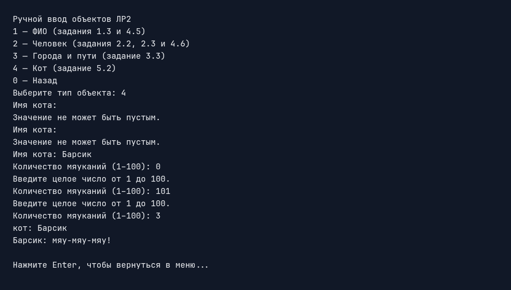

# Проверка интерфейса

## Ошибка выбора лабораторной работы

Неверный формат и номера вне диапазона главного меню.

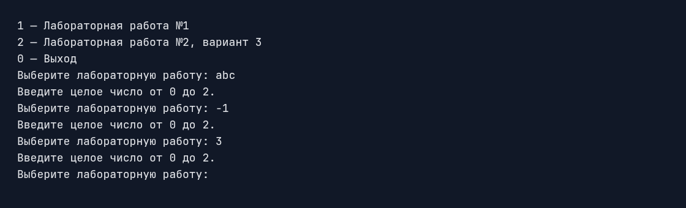

## Ошибка выбора пункта ЛР2

Неверный формат и номера вне диапазона меню лабораторной работы.

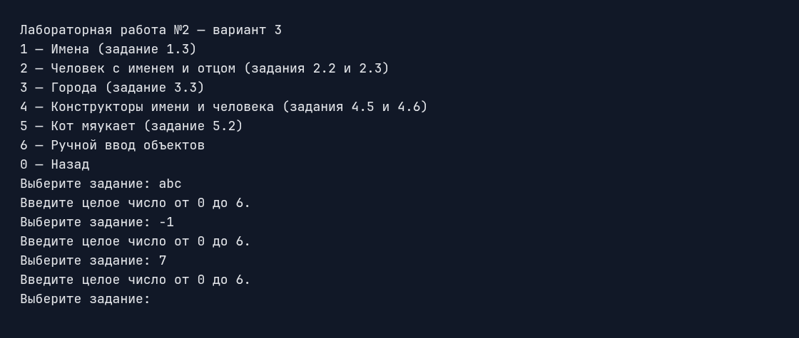

## Ошибка выбора типа объекта

Неверный формат и номера вне диапазона ручного ввода.

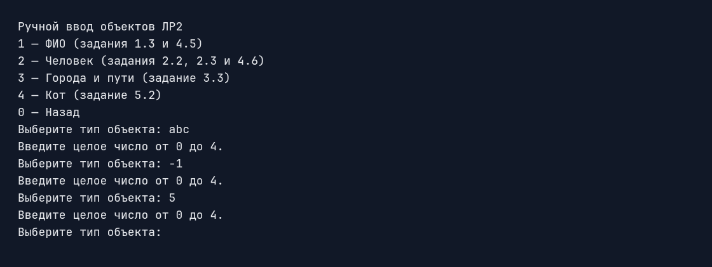

## Завершение ввода строки

Поток ввода завершён при запросе имени (Ctrl+D). Программа сообщает о завершении ввода и выходит без аварии.

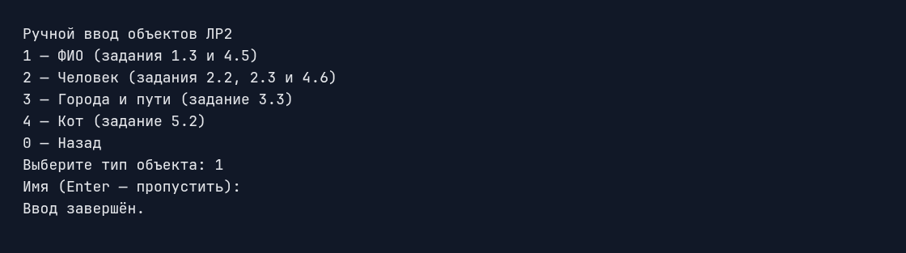

## Завершение ввода числа

Поток ввода завершён при запросе количества мяуканий (Ctrl+D). Программа завершает работу без аварии.

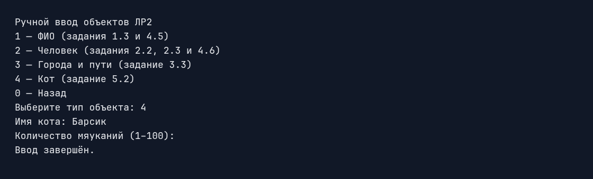

# Вывод

Реализованы семь задач варианта 3, объединённых в пять пунктов меню. Использованы составные объекты, ссылки между объектами, списки путей, перегруженные конструкторы и методы, явные свойства и ToString. Проверены примеры из условия, ручной ввод объектов, обработка некорректных данных и возврат в меню после нажатия Enter. При сборке ошибок и предупреждений не обнаружено.

Запуск: dotnet run --project CSharpLabs/CSharpLabs.csproj. В главном меню выбрать 2, затем номер задания.

Исходное задание: [lab2_charp.pdf](lab2_charp.pdf). [Снимки запусков](screenshots/live/).
