# Братилов Захар, группа ИТ-1,2. Лабораторная работа №3

Вариант 3. Выполнены задачи 1.3, 2.3, 3.3, 4.3, 5.3, 6.3, 7.3 и 8.3 в одном проекте .NET 10. Задания 1–3 реализованы в классе Matrix, задания 4–8 — в статическом классе FileTasks.

В меню лабораторной работы пункты 1–8 запускают задания с вводом параметров. Пункт 9 открывает отдельные демонстрационные примеры с готовыми данными. При неверном вводе значение запрашивается повторно. В обычном режиме используется Random.Shared, в демонстрациях — new Random(3) для повторяемости результатов. Файлы создаются в labs/Lab3/data относительно текущего рабочего каталога; он может отличаться от папки бинарника и от корня репозитория. Изображения показывают транскрипты реальных запусков: введённые значения видны рядом с приглашениями. Они оформлены как в ЛР2; это визуализация ввода и вывода, а не снимки окна терминала. Входные данные ручных проверок также приведены в таблицах. Проверка матричного выражения подтверждена снимком онлайн-калькулятора.

# Организация программы

Классы Task1–Task8 находятся в папке Tasks. Они запускают задания и показывают результаты. Общие классы и структуры находятся в Lab3/Common. Меню ЛР3 находится в Lab3.cs.

| Файл | Назначение |
| --- | --- |
| Lab3.cs | Меню и обработка ошибок. |
| Tasks/Task1.cs — Task8.cs | Запуск каждого задания и вывод. |
| Common/Lab3Input.cs | Ввод и проверка параметров. |
| Common/Lab3Files.cs | Путь к каталогу данных. |
| Common/Matrix.cs | Конструкторы и алгоритмы заданий 1–3. |
| Common/FileTasks.cs | Статические методы заданий 4–8. |
| Common/BaggageItem.cs, Common/Passenger.cs | Структуры для задания 5. |

Пункты меню 1–8 запускают обычное выполнение с вводом параметров. Для готового примера нужно выбрать 9, затем номер задания. Во всех классах готовые примеры названы RunExample. Оба режима используют одни и те же методы выполнения. В Task1.Run задаются n и m, а new Matrix(n, m) читает элементы первой матрицы.

**Подготовка каталога данных**

```csharp
namespace CSharpLabs.Lab3.Common;

internal static class Lab3Files
{
    public static string GetDataPath(string name)
    {
        string directory = Path.Combine("labs", "Lab3", "data");
        Directory.CreateDirectory(directory);
        return Path.Combine(directory, name);
    }
}
```

В каждом задании далее приведены алгоритм, код запуска, результат демонстрации и отдельная ручная проверка. Полный код Matrix дан один раз в задании 1; класс Lab3Input приведён после задания 8.

## Требования и ограничения

Задания 1–3 реализованы в одном классе Matrix с единственным полем — двумерным массивом. Заполнение выполняют конструкторы; для выражения перегружены операторы, для вывода — ToString. Задания 4–8 реализованы статическими методами FileTasks. В заданиях 4, 6 и 7 исходные числа создаются отдельным методом случайного заполнения. В задании 5 используются структуры и XML-сериализация.

В интерфейсе размеры матриц ограничены 20, количество чисел — 100, пассажиров и единиц багажа — 20, строк текста — 30. Это ограничения ручного ввода для удобства проверки, а не дополнительные условия математических задач.

# Задание 1. Заполнение двумерных массивов

## Задача 1.3. Заполнение матриц

Для выполнения задания был создан класс Matrix.

### Класс Matrix

Matrix хранит элементы в единственном поле long[,] _values. Конструктор Matrix(n, m) читает первую матрицу по столбцам; Matrix(n, random) заполняет вторую случайно; Matrix(n) строит третью по рисунку. Ещё один конструктор копирует готовый массив. Размеры и элементы доступны через Rows, Columns и индексатор; ToString формирует таблицу.

Во всех трёх матрицах используется одно n. При случайном заполнении условие row + column < n − 1 выделяет область выше побочной диагонали. Третья матрица заполняется числами 1, 2, 3… по диагоналям от правого нижнего угла. На каждой диагонали движение идёт вверх и вправо; остальные элементы остаются нулевыми.

**Полный код Matrix для заданий 1–3**

```csharp
using System.Globalization;
using System.Text;
using CSharpLabs.Common;

namespace CSharpLabs.Lab3.Common;

public class Matrix
{
    private readonly long[,] _values;

    /// <summary>Вводит прямоугольную матрицу по столбцам сверху вниз.</summary>
    public Matrix(int rows, int columns)
    {
        ValidateDimensions(rows, columns);
        _values = new long[rows, columns];

        for (int column = 0; column < columns; column++)
        {
            for (int row = 0; row < rows; row++)
            {
                _values[row, column] = ConsoleInput.ReadInt(
                    $"Элемент [{row + 1}, {column + 1}]: ", int.MinValue, int.MaxValue);
            }
        }
    }

    public Matrix(int size, Random random)
    {
        ValidateDimensions(size, size);
        ArgumentNullException.ThrowIfNull(random);
        _values = new long[size, size];

        for (int row = 0; row < size; row++)
        {
            for (int column = 0; column < size; column++)
            {
                if (row + column < size - 1)
                {
                    _values[row, column] = random.Next(-12, 4566);
                }
                else
                {
                    _values[row, column] = random.Next(-1024, 1025);
                }
            }
        }
    }

    /// <summary>Заполняет нижний правый треугольник по диагоналям от правого нижнего угла.</summary>
    public Matrix(int size)
    {
        ValidateDimensions(size, size);
        _values = new long[size, size];
        long value = 1;

        for (int diagonal = 0; diagonal < size; diagonal++)
        {
            for (int offset = 0; offset <= diagonal; offset++)
            {
                _values[size - 1 - offset, size - 1 - diagonal + offset] = value;
                value++;
            }
        }
    }

    /// <summary>Создаёт независимую копию переданного массива.</summary>
    public Matrix(long[,] values)
    {
        ArgumentNullException.ThrowIfNull(values);
        ValidateDimensions(values.GetLength(0), values.GetLength(1));
        _values = (long[,])values.Clone();
    }

    public int Rows
    {
        get
        {
            return _values.GetLength(0);
        }
    }

    public int Columns
    {
        get
        {
            return _values.GetLength(1);
        }
    }

    public long this[int row, int column]
    {
        get
        {
            return _values[row, column];
        }
    }

    /// <summary>Находит первый при обходе по строкам блок 3×3 с максимальной суммой.</summary>
    public Matrix FindMaximumBlock(out int top, out int left, out long sum)
    {
        if (Rows < 3 || Columns < 3)
        {
            throw new InvalidOperationException("Для блока 3×3 нужны минимум три строки и три столбца.");
        }

        top = 0;
        left = 0;
        sum = long.MinValue;
        long current = 0;

        for (int row = 0; row <= Rows - 3; row++)
        {
            for (int column = 0; column <= Columns - 3; column++)
            {
                current = 0;

                for (int i = 0; i < 3; i++)
                {
                    for (int j = 0; j < 3; j++)
                    {
                        current = checked(current + _values[row + i, column + j]);
                    }
                }

                if (current > sum)
                {
                    sum = current;
                    top = row;
                    left = column;
                }
            }
        }

        long[,] block = new long[3, 3];

        for (int row = 0; row < 3; row++)
        {
            for (int column = 0; column < 3; column++)
            {
                block[row, column] = _values[top + row, left + column];
            }
        }

        return new Matrix(block);
    }

    public Matrix Transpose()
    {
        long[,] result = new long[Columns, Rows];

        for (int row = 0; row < Rows; row++)
        {
            for (int column = 0; column < Columns; column++)
            {
                result[column, row] = _values[row, column];
            }
        }

        return new Matrix(result);
    }

    public static Matrix operator +(Matrix first, Matrix second)
    {
        ArgumentNullException.ThrowIfNull(first);
        ArgumentNullException.ThrowIfNull(second);

        if (first.Rows != second.Rows || first.Columns != second.Columns)
        {
            throw new ArgumentException("Размеры слагаемых матриц должны совпадать.");
        }

        long[,] result = new long[first.Rows, first.Columns];

        for (int row = 0; row < first.Rows; row++)
        {
            for (int column = 0; column < first.Columns; column++)
            {
                result[row, column] = checked(first[row, column] + second[row, column]);
            }
        }

        return new Matrix(result);
    }

    public static Matrix operator *(long factor, Matrix matrix)
    {
        ArgumentNullException.ThrowIfNull(matrix);
        long[,] result = new long[matrix.Rows, matrix.Columns];

        for (int row = 0; row < matrix.Rows; row++)
        {
            for (int column = 0; column < matrix.Columns; column++)
            {
                result[row, column] = checked(factor * matrix[row, column]);
            }
        }

        return new Matrix(result);
    }

    public static Matrix operator *(Matrix matrix, long factor)
    {
        return factor * matrix;
    }

    public override string ToString()
    {
        int width = 1;

        foreach (long value in _values)
        {
            width = Math.Max(width, value.ToString(CultureInfo.InvariantCulture).Length);
        }

        StringBuilder result = new StringBuilder();
        string formattedValue = string.Empty;

        for (int row = 0; row < Rows; row++)
        {
            for (int column = 0; column < Columns; column++)
            {
                if (column > 0)
                {
                    result.Append(' ');
                }

                formattedValue = _values[row, column].ToString(CultureInfo.InvariantCulture);
                result.Append(formattedValue.PadLeft(width));
            }

            if (row < Rows - 1)
            {
                result.AppendLine();
            }
        }

        return result.ToString();
    }

    private static void ValidateDimensions(int rows, int columns)
    {
        ArgumentOutOfRangeException.ThrowIfNegativeOrZero(rows);
        ArgumentOutOfRangeException.ThrowIfNegativeOrZero(columns);
    }
}
```

### Условие

Первый массив n×m заполняется с клавиатуры по столбцам сверху вниз. Во втором массиве n×n выше побочной диагонали находятся случайные целые числа [-12; 4565], на диагонали и ниже — [-1024; 1024]. Третий массив заполняется по рисунку для произвольного n. Во всех трёх матрицах используется одно и то же n. Третья матрица заполняется по заданной закономерности, а не случайно.

### Описание задачи

Порядок выполнения примера:

1. В обычном запуске первая матрица n×m вводится с клавиатуры по столбцам сверху вниз. Для иллюстрации в демонстрационном режиме подготовлена матрица 5×3 с числами от 1 до 15.
2. Вторая матрица n×n создаётся случайно в заданных диапазонах; n совпадает с числом строк первой матрицы.
3. Третья матрица n×n заполняется по закономерности рисунка, без случайных чисел. При n=5 получается рисунок из условия; все три матрицы выводятся через ToString.

### Код примера

**Полный код Task1: запуск и пример**

```csharp
using CSharpLabs.Common;
using CSharpLabs.Lab3.Common;

namespace CSharpLabs.Lab3.Tasks;

internal static class Task1
{
    public static void Run()
    {
        Console.WriteLine("Первая матрица: ввод по столбцам сверху вниз.");
        int n = ConsoleInput.ReadInt("Число строк n (1–20): ", 1, 20);
        int m = ConsoleInput.ReadInt("Число столбцов m (1–20): ", 1, 20);
        Matrix first = new Matrix(n, m);
        Run(first);
    }

    public static void RunExample()
    {
        Console.WriteLine("Готовая первая матрица: числа 1–15 расположены по столбцам.");
        Run(new Matrix(new long[,]
        {
            { 1, 6, 11 },
            { 2, 7, 12 },
            { 3, 8, 13 },
            { 4, 9, 14 },
            { 5, 10, 15 }
        }), new Random(3));
    }

    public static void Run(Matrix first, Random? random = null)
    {
        int n = first.Rows;
        Console.WriteLine($"Размеры: первая матрица {n}×{first.Columns}, вторая и третья {n}×{n}.");
        Console.WriteLine("Первая матрица:");
        Console.WriteLine(first);
        Console.WriteLine("Вторая матрица: выше побочной [-12;4565], на ней и ниже [-1024;1024]:");
        Console.WriteLine(new Matrix(n, random ?? Random.Shared));
        Console.WriteLine("Третья матрица: заполнение по рисунку, без случайных чисел:");
        Console.WriteLine(new Matrix(n));
    }
}
```

### Результат

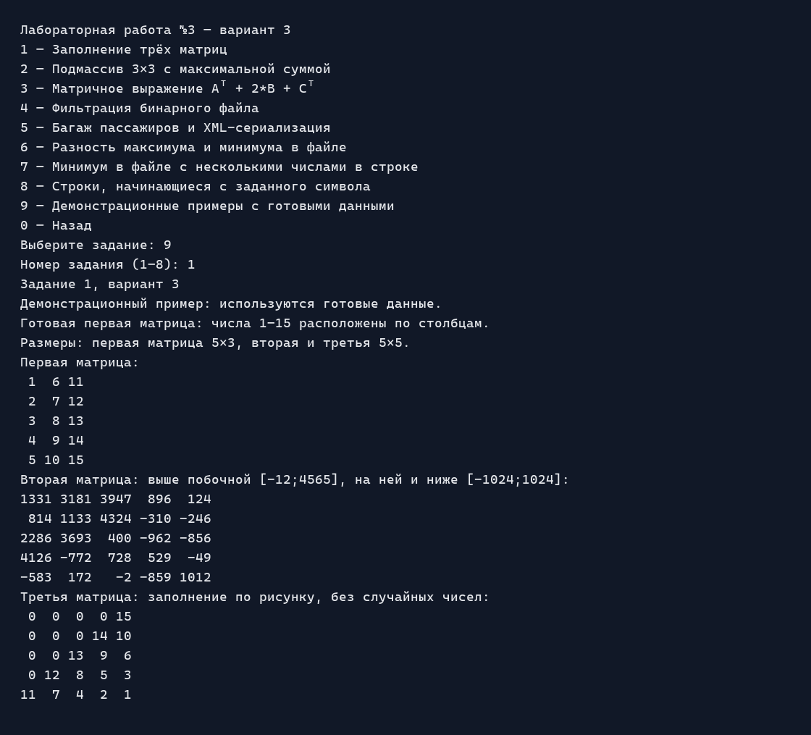

### Ручной ввод и проверка

Пункт 1: ввод 1–6 по столбцам в матрицу 2×3 даёт строки 1 3 5 и 2 4 6. Обе квадратные матрицы имеют размер 2×2: вторая заполняется случайно, третья — по рисунку. Отдельного ввода n для них нет.

| Параметр | Введённые значения |
| --- | --- |
| Размер первой матрицы | 2 строки (n), 3 столбца (m) |
| Элементы по столбцам | 1, 2, 3, 4, 5, 6 |
| Размер второй и третьей матриц | 2×2, определяется автоматически |

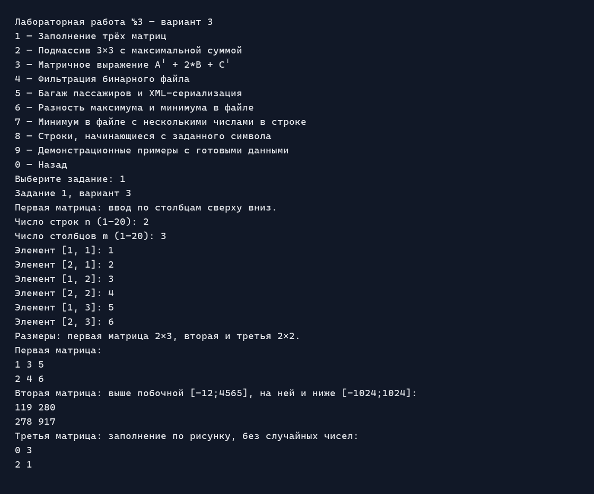

# Задание 2. Работа с двумерными массивами

## Задача 2.3. Подмассив с максимальной суммой

Для выполнения задания в класс Matrix был добавлен метод FindMaximumBlock.

### Метод поиска в классе Matrix

FindMaximumBlock перебирает позиции левого верхнего угла: от 0 до Rows − 3 и от 0 до Columns − 3 включительно. Для каждой позиции складываются девять элементов. Блоки могут перекрываться, а размеры массива не обязаны делиться на три.

Метод сохраняет наибольшую сумму и координаты блока. Начальное значение long.MinValue позволяет работать с отрицательными числами. При равных суммах выбирается первый блок при обходе по строкам. На экран координаты выводятся с единицы.

Полный код класса Matrix приведён в задаче 1.3.

### Условие

В массиве n×m найти подмассив 3×3 с максимальной суммой. Размеры могут быть не кратны трём.

### Описание задачи

Порядок выполнения примера:

1. Создана исходная матрица 4×5 с числами от 1 до 20.
2. Метод FindMaximumBlock проверил все возможные положения блока 3×3.
3. Выведены найденный блок, его сумма 126 и начало: строка 2, столбец 3.

### Код примера

**Полный код Task2: запуск и пример**

```csharp
using CSharpLabs.Lab3.Common;

namespace CSharpLabs.Lab3.Tasks;

internal static class Task2
{
    public static void RunExample()
    {
        Run(new Matrix(new long[,]
        {
            { 1, 2, 3, 4, 5 },
            { 6, 7, 8, 9, 10 },
            { 11, 12, 13, 14, 15 },
            { 16, 17, 18, 19, 20 }
        }));
    }

    public static void Run(Matrix matrix)
    {
        Console.WriteLine("Исходная матрица:");
        Console.WriteLine(matrix);
        int row = 0;
        int column = 0;
        long sum = 0;
        Matrix block = matrix.FindMaximumBlock(out row, out column, out sum);
        Console.WriteLine($"Начало блока: строка {row + 1}, столбец {column + 1}; сумма = {sum}.");
        Console.WriteLine(block);
    }
}
```

### Результат

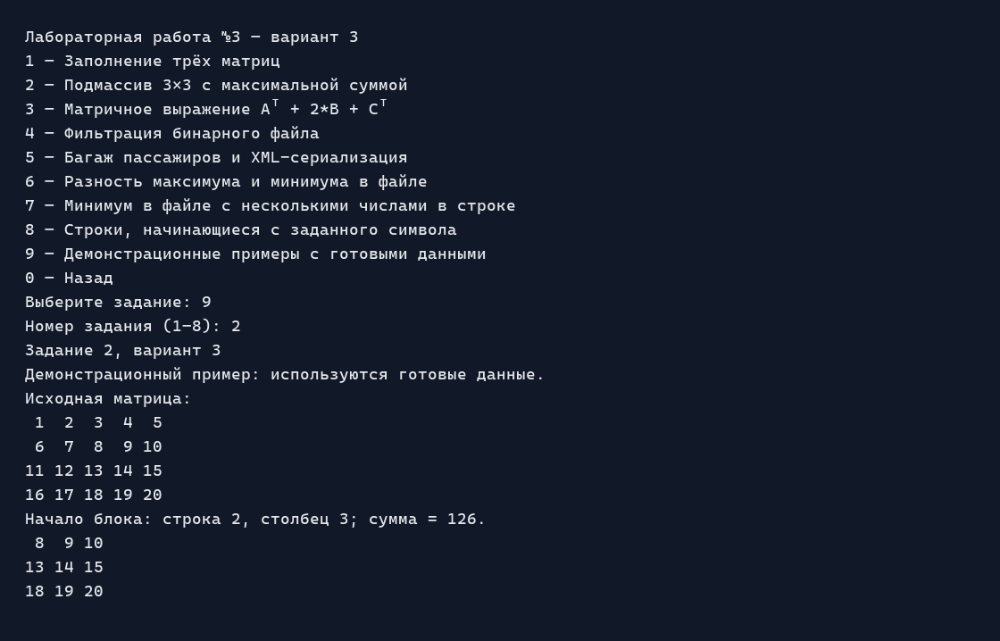

### Ручной ввод и проверка

Пункт 2: отрицательный массив 3×4 даёт максимальную сумму −63 в блоке с первого ряда, второго столбца. Проверяется крайний правый блок.

| Параметр | Введённые значения |
| --- | --- |
| Размер матрицы | 3 строки, 4 столбца |
| Столбцы в порядке ввода | (-10, -10, -10); (-10, -10, -10); (-10, -10, -10); (-1, -1, -1) |

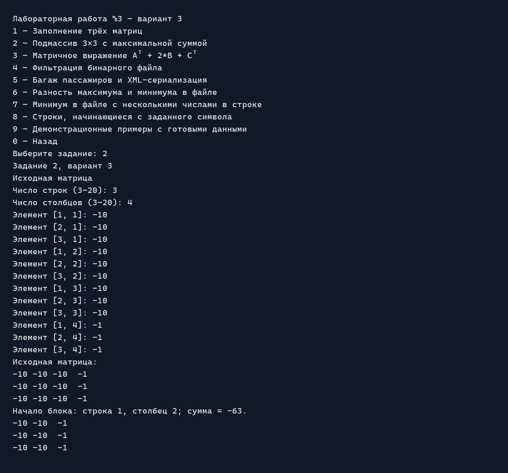

# Задание 3. Работа с двумерными массивами как с матрицами

## Задача 3.3. Матричное выражение

Для выполнения задания в класс Matrix были добавлены транспонирование и перегруженные операторы.

### Операции класса Matrix

Transpose меняет строки и столбцы местами. Операторы + и * перегружены для сложения матриц и умножения матрицы на число. Поэтому выражение записано как a.Transpose() + 2 * b + c.Transpose(). Приоритет остаётся обычным: умножение выполняется раньше сложения.

Матрицы A и C должны иметь одинаковые размеры, а B — размеры их транспонированных матриц. Квадратность не требуется. Операции создают новые матрицы; исходные не изменяются. checked обнаруживает переполнение long.

Полный код класса Matrix приведён в задаче 1.3.

### Условие

Вычислить Aᵀ + 2B + Cᵀ, перегрузив необходимые операторы. Вывод матриц реализовать через ToString. Приложить снимок проверки в онлайн-калькуляторе.

### Описание задачи

Порядок выполнения примера:

1. Созданы матрицы A, B и C размера 2×2.
2. С помощью Transpose и перегруженных операторов вычислено Aᵀ + 2B + Cᵀ.
3. Выведен результат; выражение проверено в онлайн-калькуляторе.

### Код примера

**Полный код Task3: запуск и пример**

```csharp
using CSharpLabs.Lab3.Common;

namespace CSharpLabs.Lab3.Tasks;

internal static class Task3
{
    public static void RunExample()
    {
        Run(
            new Matrix(new long[,] { { 1, 2 }, { 3, 4 } }),
            new Matrix(new long[,] { { 5, 6 }, { 7, 8 } }),
            new Matrix(new long[,] { { 9, 10 }, { 11, 12 } }));
    }

    public static void Run(Matrix a, Matrix b, Matrix c)
    {
        Console.WriteLine($"A:\n{a}\nB:\n{b}\nC:\n{c}");
        Matrix result = a.Transpose() + 2 * b + c.Transpose();
        Console.WriteLine($"Aᵀ + 2*B + Cᵀ:\n{result}");
    }
}
```

### Результат

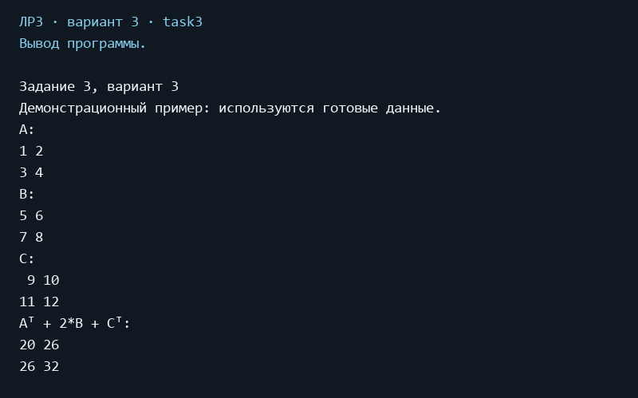

### Ручной ввод и проверка

Пункт 3: A и C размера 1×2 и B размера 2×1 дают прямоугольный результат с элементами 12 и 16.

| Параметр | Введённые значения |
| --- | --- |
| Размер A и C | 1 строка, 2 столбца |
| A по столбцам | 1, 2 |
| B по столбцам | 3, 4 |
| C по столбцам | 5, 6 |

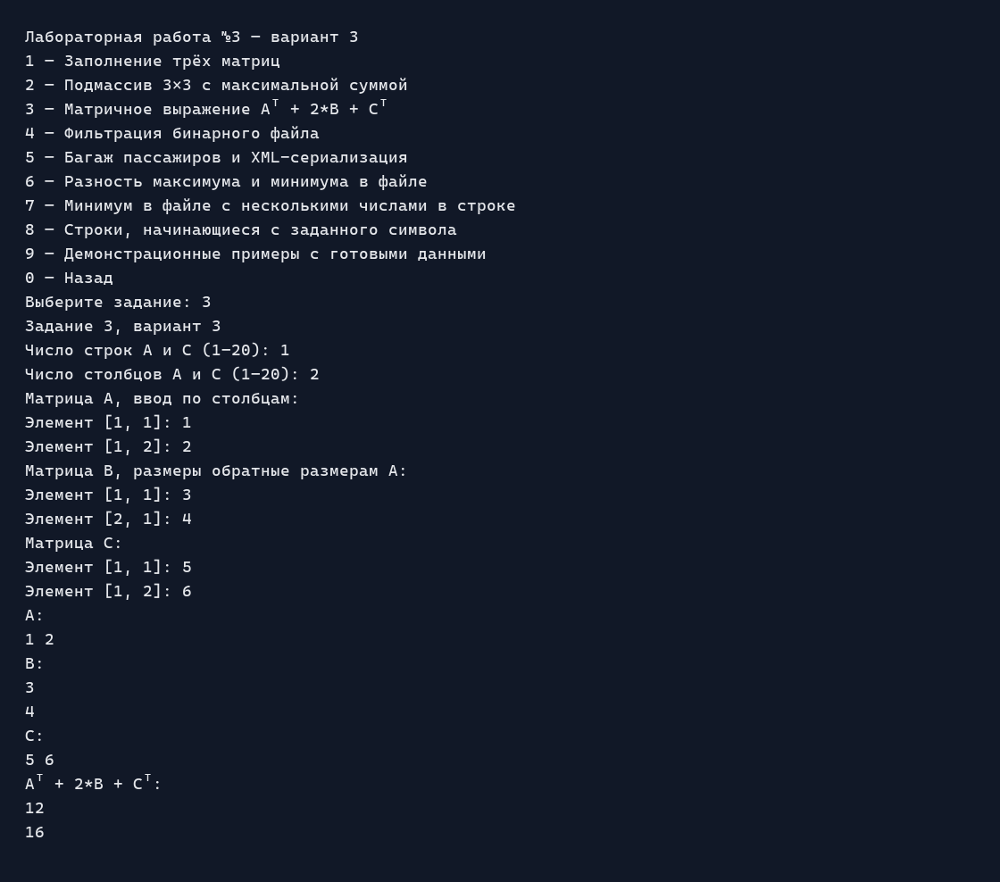

### Независимая проверка выражения

Для демонстрации A=[[1,2],[3,4]], B=[[5,6],[7,8]], C=[[9,10],[11,12]]. Aᵀ=[[1,3],[2,4]], 2B=[[10,12],[14,16]], Cᵀ=[[9,11],[10,12]]. Поэлементная сумма равна [[20,26],[26,32]] и совпадает с программой.

Проверка в [онлайн-калькуляторе MatrixCalc](https://matrixcalc.org/ru/): выражение `{{1,2},{3,4}}^T+2*{{5,6},{7,8}}+{{9,10},{11,12}}^T` даёт тот же результат [[20,26],[26,32]].

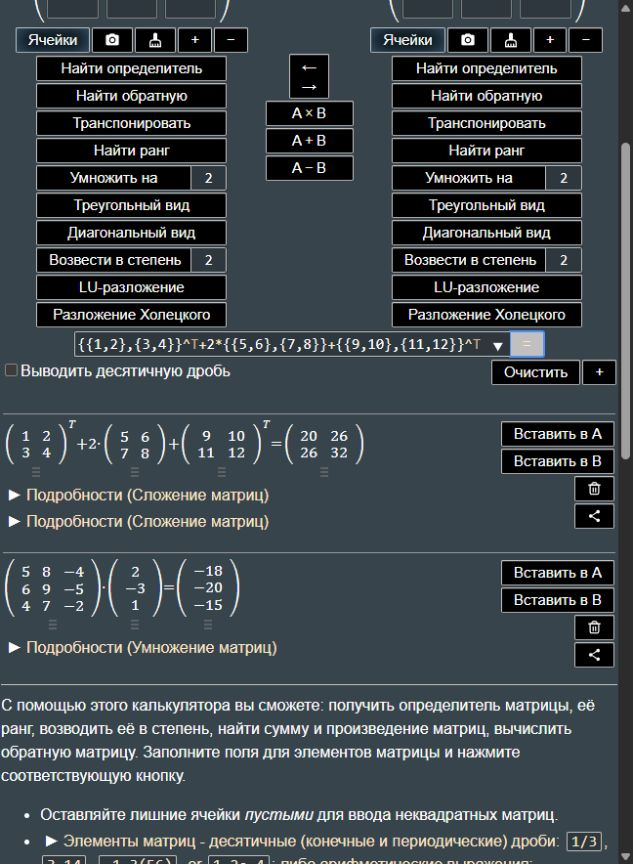

# Задание 4. Бинарные файлы

## Задача 4.3. Фильтрация чисел

Для выполнения задания был создан статический класс FileTasks.

### Статический класс FileTasks

FillBinaryNumbers создаёт исходный файл со случайными целыми числами от −100 до 100. FilterBinaryNumbers читает их по очереди и сохраняет числа, для которых value % m == 0 и value % n != 0. Порядок и повторения сохраняются.

Делители m и n не могут быть нулевыми. Число 0 не попадает в результат, поскольку делится на оба делителя. Приведение value к long предотвращает переполнение для int.MinValue % −1. Входной бинарный файл должен состоять из целых записей Int32.

**Методы FileTasks**

```csharp
public static void FillBinaryNumbers(string path, int count, Random random)
{
    ArgumentOutOfRangeException.ThrowIfNegative(count);
    ArgumentNullException.ThrowIfNull(random);
    using BinaryWriter writer = new BinaryWriter(File.Create(path));

    for (int i = 0; i < count; i++)
    {
        writer.Write(random.Next(-100, 101));
    }
}

public static void FilterBinaryNumbers(string source, string destination, int m, int n)
{
    ValidateDifferentPaths(source, destination);

    if (m == 0 || n == 0)
    {
        throw new ArgumentException("Делители m и n не должны быть равны нулю.");
    }

    using BinaryReader reader = new BinaryReader(File.OpenRead(source));

    if (reader.BaseStream.Length % sizeof(int) != 0)
    {
        throw new InvalidDataException("Бинарный файл должен содержать целые Int32.");
    }

    using BinaryWriter writer = new BinaryWriter(File.Create(destination));
    int value = 0;

    while (reader.BaseStream.Position < reader.BaseStream.Length)
    {
        value = reader.ReadInt32();

        // Расширение до long исключает переполнение int.MinValue % -1.
        if ((long)value % m == 0 && (long)value % n != 0)
        {
            writer.Write(value);
        }
    }
}

public static string ReadBinaryNumbers(string path)
{
    using BinaryReader reader = new BinaryReader(File.OpenRead(path));

    if (reader.BaseStream.Length % sizeof(int) != 0)
    {
        throw new InvalidDataException("Бинарный файл должен содержать целые Int32.");
    }

    StringBuilder result = new StringBuilder();

    while (reader.BaseStream.Position < reader.BaseStream.Length)
    {
        if (result.Length > 0)
        {
            result.Append(' ');
        }

        result.Append(reader.ReadInt32());
    }

    if (result.Length == 0)
    {
        return "(пусто)";
    }
    else
    {
        return result.ToString();
    }
}

private static void ValidateDifferentPaths(string source, string destination)
{
    if (string.Equals(Path.GetFullPath(source), Path.GetFullPath(destination),
        StringComparison.OrdinalIgnoreCase))
    {
        throw new ArgumentException("Исходный и выходной файлы должны различаться.");
    }
}
```

### Условие

Получить в новом бинарном файле все компоненты исходного, которые делятся на m и не делятся на n. Исходный файл заполнить случайными числами отдельным методом.

### Описание задачи

Порядок выполнения примера:

1. Метод FillBinaryNumbers заполнил исходный бинарный файл двадцатью случайными числами.
2. При m=3 и n=2 метод FilterBinaryNumbers записал в новый файл подходящие числа.
3. Содержимое обоих файлов выведено для сравнения.

### Код примера

**Полный код Task4: запуск и пример**

```csharp
using CSharpLabs.Lab3.Common;

namespace CSharpLabs.Lab3.Tasks;

internal static class Task4
{
    public static void RunExample()
    {
        Run(20, 3, 2, new Random(3));
    }

    public static void Run(int count, int m, int n, Random? random = null)
    {
        string source = Lab3Files.GetDataPath("numbers.bin");
        string destination = Lab3Files.GetDataPath("filtered.bin");
        FileTasks.FillBinaryNumbers(source, count, random ?? Random.Shared);
        FileTasks.FilterBinaryNumbers(source, destination, m, n);
        Console.WriteLine($"Исходный файл: {source}\n{FileTasks.ReadBinaryNumbers(source)}");
        Console.WriteLine($"m = {m}, n = {n}");
        Console.WriteLine($"Результат: {destination}\n{FileTasks.ReadBinaryNumbers(destination)}");
    }
}
```

### Результат

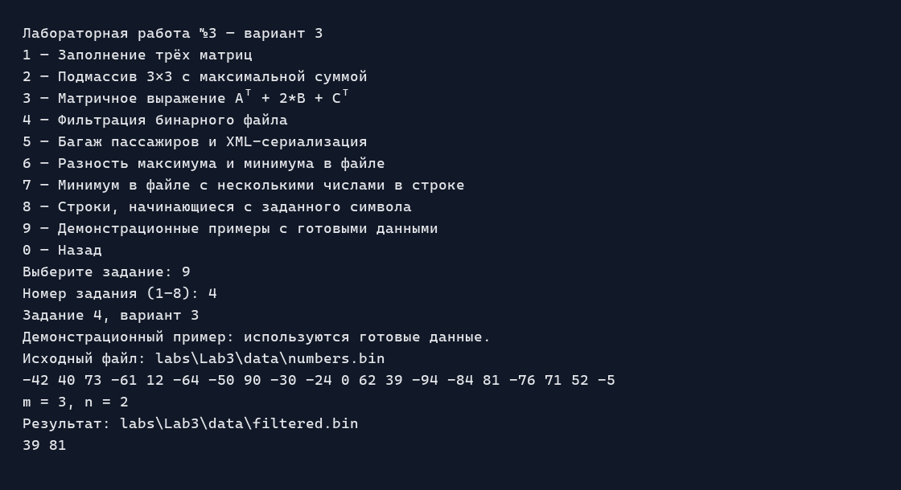

### Ручной ввод и проверка

Пункт 4: пустой исходный файл создаёт пустой результат; нулевой делитель отклоняется с повторным запросом.

| Параметр | Введённые значения |
| --- | --- |
| Количество чисел | 0 |
| Делитель m | 0 (ошибка), затем 3 |
| Делитель n | 2 |

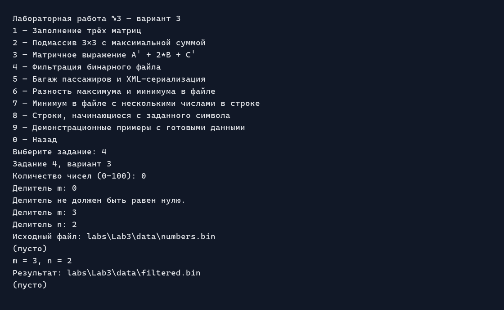

# Задание 5. Бинарные файлы и структуры

## Задача 5.3. Багаж пассажиров

Для выполнения задания были созданы структуры BaggageItem и Passenger и добавлены методы в FileTasks.

### Структуры BaggageItem и Passenger и методы FileTasks

BaggageItem — структура с названием и массой одной единицы багажа. Passenger — структура с именем пассажира и массивом BaggageItem. Для массы используется decimal. FillPassengers преобразует массив пассажиров в XML через XmlSerializer и записывает его в файл.

Формат файла: сначала длина XML в байтах (Int32, четыре байта), затем сами байты XML. Это выбранный формат контейнера; длина не является требованием XML-сериализации. ReadPassengers проверяет длину и восстанавливает массив. Затем HasLightSingleBaggage ищет пассажира ровно с одним предметом, масса которого строго меньше m. Предмет с массой, равной m, не подходит под это условие.

**Полный код BaggageItem**

```csharp
namespace CSharpLabs.Lab3.Common;

public struct BaggageItem
{
    private string? _name;
    private decimal _mass;

    public BaggageItem(string name, decimal mass)
    {
        _name = null;
        _mass = 0;
        Name = name;
        Mass = mass;
    }

    public string Name
    {
        get
        {
            return _name ?? string.Empty;
        }
        set
        {
            ArgumentException.ThrowIfNullOrWhiteSpace(value);
            _name = value.Trim();
        }
    }

    public decimal Mass
    {
        get
        {
            return _mass;
        }
        set
        {
            if (value <= 0)
            {
                throw new ArgumentOutOfRangeException(nameof(value), "Масса должна быть положительной.");
            }

            _mass = value;
        }
    }
}
```

**Полный код Passenger**

```csharp
namespace CSharpLabs.Lab3.Common;

public struct Passenger
{
    private string? _name;
    private BaggageItem[]? _items;

    public Passenger(string name, BaggageItem[] items)
    {
        _name = null;
        _items = null;
        Name = name;
        Items = items;
    }

    public string Name
    {
        get
        {
            return _name ?? string.Empty;
        }
        set
        {
            ArgumentException.ThrowIfNullOrWhiteSpace(value);
            _name = value.Trim();
        }
    }

    public BaggageItem[] Items
    {
        get
        {
            return _items ?? Array.Empty<BaggageItem>();
        }
        set
        {
            ArgumentNullException.ThrowIfNull(value);
            _items = value;
        }
    }
}
```

**Методы FileTasks**

```csharp
public static void FillPassengers(string path, Passenger[] passengers)
{
    ArgumentNullException.ThrowIfNull(passengers);
    XmlSerializer serializer = new XmlSerializer(typeof(Passenger[]));
    using MemoryStream xml = new MemoryStream();
    serializer.Serialize(xml, passengers);
    byte[] data = xml.ToArray();
    using BinaryWriter writer = new BinaryWriter(File.Create(path));
    writer.Write(data.Length);
    writer.Write(data);
}

public static Passenger[] ReadPassengers(string path)
{
    using BinaryReader reader = new BinaryReader(File.OpenRead(path));

    if (reader.BaseStream.Length < sizeof(int))
    {
        throw new InvalidDataException("В файле отсутствует заголовок длины XML.");
    }

    int length = reader.ReadInt32();

    if (length < 0 || length != reader.BaseStream.Length - sizeof(int))
    {
        throw new InvalidDataException("Повреждена длина XML в бинарном файле.");
    }

    using MemoryStream xml = new MemoryStream(reader.ReadBytes(length));
    XmlSerializer serializer = new XmlSerializer(typeof(Passenger[]));
    return (Passenger[])(serializer.Deserialize(xml)
        ?? throw new InvalidDataException("В файле нет массива пассажиров."));
}

public static bool HasLightSingleBaggage(string path, decimal m)
{
    Passenger[] passengers = ReadPassengers(path);

    foreach (Passenger passenger in passengers)
    {
        if (passenger.Items.Length == 1 && passenger.Items[0].Mass < m)
        {
            return true;
        }
    }

    return false;
}
```

### Условие

Багаж пассажира — массив структур с названием и массой единицы багажа. Выяснить, имеется ли пассажир с одной единицей багажа массой менее m кг. Заполнение файла выполнить отдельным методом с обязательной XML-сериализацией.

### Описание задачи

Порядок выполнения примера:

1. Созданы три пассажира с массивами единиц багажа и задан порог m=5 кг.
2. Массив пассажиров сериализован в XML и записан в бинарный контейнер, затем прочитан обратно.
3. Проверено наличие пассажира с единственной единицей багажа массой менее 5 кг; получен ответ «Да».

### Код примера

**Полный код Task5: запуск и пример**

```csharp
using CSharpLabs.Lab3.Common;

namespace CSharpLabs.Lab3.Tasks;

internal static class Task5
{
    public static void RunExample()
    {
        Passenger[] passengers =
        {
            new Passenger("Анна", new[] { new BaggageItem("Сумка", 4) }),
            new Passenger("Борис", new[] { new BaggageItem("Чемодан", 12), new BaggageItem("Коробка", 2) }),
            new Passenger("Вера", new[] { new BaggageItem("Рюкзак", 5) })
        };
        Run(passengers, 5);
    }

    public static void Run(Passenger[] passengers, decimal m)
    {
        string path = Lab3Files.GetDataPath("passengers.bin");
        FileTasks.FillPassengers(path, passengers);
        Console.WriteLine($"Файл: {path}; XML-сериализация массива структур, затем чтение файла.");

        foreach (Passenger passenger in FileTasks.ReadPassengers(path))
        {
            Console.Write($"{passenger.Name}: {passenger.Items.Length} ед.");

            foreach (BaggageItem item in passenger.Items)
            {
                Console.Write($"; {item.Name} — {item.Mass} кг");
            }

            Console.WriteLine();
        }

        bool found = FileTasks.HasLightSingleBaggage(path, m);
        string answer = string.Empty;

        if (found)
        {
            answer = "Да";
        }
        else
        {
            answer = "Нет";
        }

        Console.WriteLine($"Одна единица багажа массой менее {m} кг: {answer}");
    }
}
```

### Результат

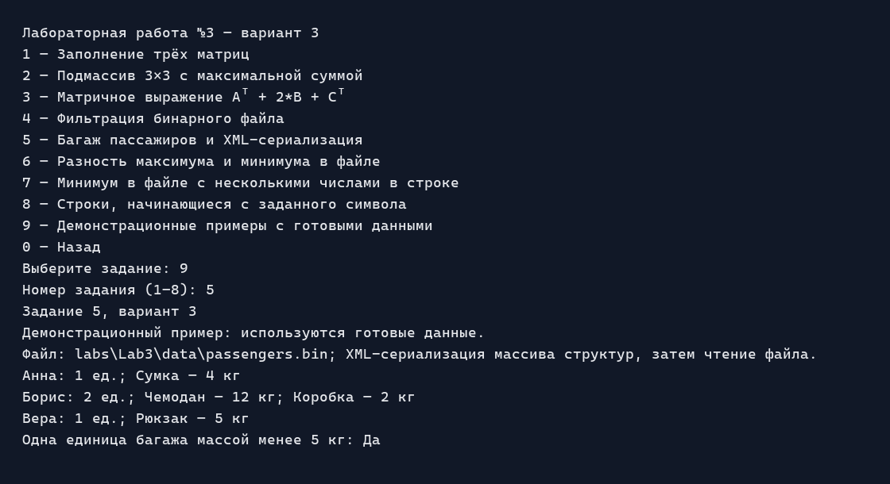

### Ручной ввод и проверка

Пункт 5: отрицательная масса отклоняется. Для одного предмета массой 5 кг и m=5 результат «Нет»: неравенство строгое. Дроби принимаются с точкой или запятой.

| Параметр | Введённые значения |
| --- | --- |
| Пассажиры | 1, имя Тест |
| Багаж | 1 единица, название Сумка |
| Масса | -1 (ошибка), затем 5,0 кг |
| Порог m | 5 кг |

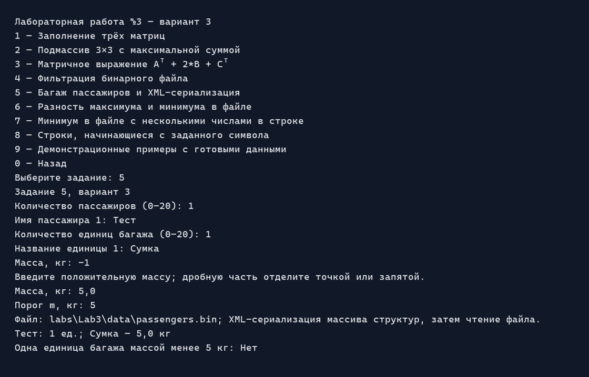

# Задание 6. Текстовые файлы: одно число в строке

## Задача 6.3. Разность максимума и минимума

Для выполнения задания в класс FileTasks были добавлены методы заполнения и обработки текстового файла.

### Методы FileTasks для чисел по одному в строке

FillTextNumbers через StreamWriter с perLine=1 записывает случайные целые числа по одному в строке. FindRange читает файл построчно через StreamReader, находит минимум и максимум, затем возвращает максимум минус минимум.

Для одного числа результат равен нулю. Разность вычисляется в long, поэтому крайние значения int не вызывают переполнения. Пустой файл отклоняется: у него нельзя определить минимум и максимум.

Для показа содержимого используется ReadText: он открывает StreamReader и вызывает ReadToEnd. Все текстовые потоки работают с UTF-8 и закрываются через using.

**Методы FileTasks**

```csharp
public static void FillTextNumbers(string path, int count, int perLine, Random random)
{
    ArgumentOutOfRangeException.ThrowIfNegative(count);
    ArgumentOutOfRangeException.ThrowIfNegativeOrZero(perLine);
    ArgumentNullException.ThrowIfNull(random);
    using StreamWriter writer = new StreamWriter(path, false, Encoding.UTF8);

    for (int i = 0; i < count; i++)
    {
        writer.Write(random.Next(-100, 101).ToString(CultureInfo.InvariantCulture));

        if ((i + 1) % perLine == 0 || i == count - 1)
        {
            writer.WriteLine();
        }
        else
        {
            writer.Write(' ');
        }
    }
}

public static string ReadText(string path)
{
    using StreamReader reader = new StreamReader(path, Encoding.UTF8);
    return reader.ReadToEnd();
}

public static long FindRange(string path)
{
    using StreamReader reader = new StreamReader(path, Encoding.UTF8);
    string? line = reader.ReadLine();

    if (line is null)
    {
        throw new InvalidDataException("В файле нет чисел.");
    }

    int minimum = int.Parse(line, CultureInfo.InvariantCulture);
    int maximum = minimum;
    int value = 0;

    while ((line = reader.ReadLine()) is not null)
    {
        value = int.Parse(line, CultureInfo.InvariantCulture);
        minimum = Math.Min(minimum, value);
        maximum = Math.Max(maximum, value);
    }

    return (long)maximum - minimum;
}
```

### Условие

В текстовом файле целые числа записаны по одному в строке. Найти разность максимального и минимального элементов. Случайное заполнение — отдельным методом.

### Описание задачи

Порядок выполнения примера:

1. Исходный текстовый файл заполнен двенадцатью случайными числами по одному в строке.
2. Метод FindRange определил минимальный и максимальный элементы и вычислил их разность.
3. Выведены содержимое файла и результат вычисления.

### Код примера

**Полный код Task6: запуск и пример**

```csharp
using CSharpLabs.Lab3.Common;

namespace CSharpLabs.Lab3.Tasks;

internal static class Task6
{
    public static void RunExample()
    {
        Run(12, new Random(3));
    }

    public static void Run(int count, Random? random = null)
    {
        string path = Lab3Files.GetDataPath("task6.txt");
        FileTasks.FillTextNumbers(path, count, 1, random ?? Random.Shared);
        Console.WriteLine($"Исходный файл: {path}");
        Console.Write(FileTasks.ReadText(path));

        Console.WriteLine($"Максимум − минимум = {FileTasks.FindRange(path)}");
    }
}
```

### Результат

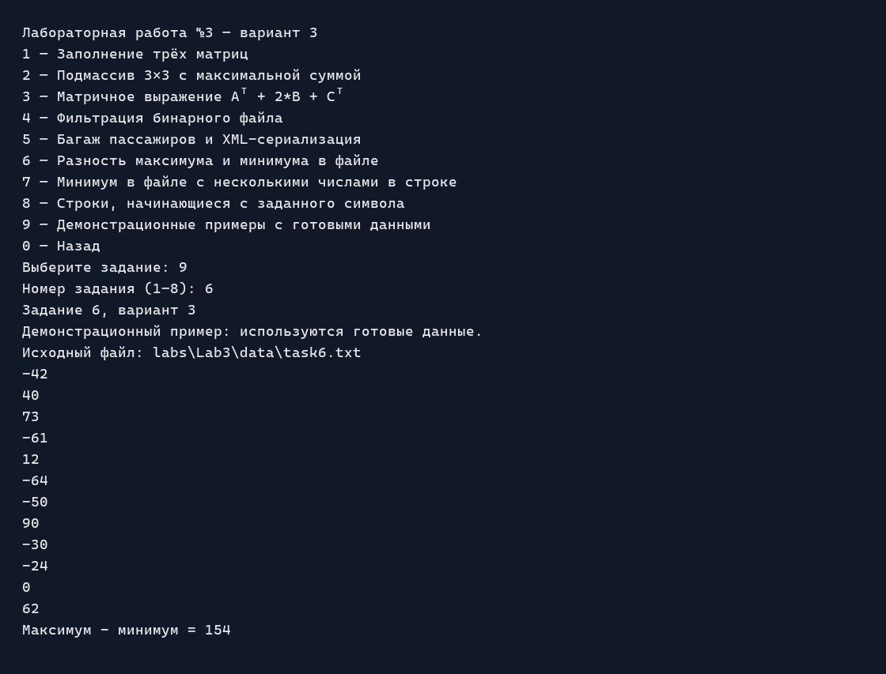

### Ручной ввод и проверка

Пункт 6: файл из одного числа даёт разность 0.

| Параметр | Введённые значения |
| --- | --- |
| Количество чисел | 1 |

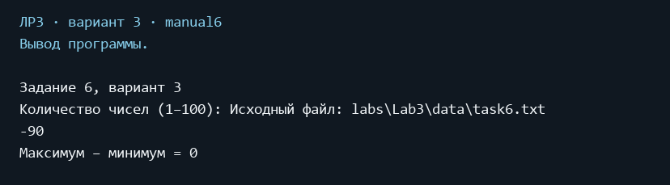

# Задание 7. Текстовые файлы: несколько чисел в строке

## Задача 7.3. Минимальный элемент

Для выполнения задания был использован метод заполнения FileTasks и добавлен метод FindMinimum.

### Методы FileTasks для нескольких чисел в строке

FillTextNumbers записывает несколько случайных чисел в строку; последняя строка может быть неполной. FindMinimum читает строки через StreamReader.ReadLine и разбивает их по пробельным символам, преобразует полученные части в числа и находит минимум.

Пробелы, табуляция и пустые строки не мешают чтению. Если чисел нет, выдаётся ошибка. В обычном запуске задаются не меньше двух чисел и от двух до десяти чисел в полной строке, но не больше общего количества.

**Методы FileTasks**

```csharp
public static int FindMinimum(string path)
{
    using StreamReader reader = new StreamReader(path, Encoding.UTF8);
    int minimum = int.MaxValue;
    bool found = false;
    string[] tokens = Array.Empty<string>();
    string? line = null;

    while ((line = reader.ReadLine()) is not null)
    {
        tokens = line.Split((char[]?)null, StringSplitOptions.RemoveEmptyEntries);

        foreach (string token in tokens)
        {
            minimum = Math.Min(minimum, int.Parse(token, CultureInfo.InvariantCulture));
            found = true;
        }
    }

    if (!found)
    {
        throw new InvalidDataException("В файле нет чисел.");
    }

    return minimum;
}
```

Методы FillTextNumbers и ReadText приведены в задании 6; здесь perLine > 1.

### Условие

В текстовом файле целые числа записаны по несколько в строке. Найти минимальный элемент. Случайное заполнение — отдельным методом.

### Описание задачи

Порядок выполнения примера:

1. Исходный текстовый файл заполнен двенадцатью случайными числами по четыре в строке.
2. Метод FindMinimum обработал все числа и определил минимальное значение.
3. Выведены содержимое файла и найденный минимум.

### Код примера

**Полный код Task7: запуск и пример**

```csharp
using CSharpLabs.Lab3.Common;

namespace CSharpLabs.Lab3.Tasks;

internal static class Task7
{
    public static void RunExample()
    {
        Run(12, 4, new Random(3));
    }

    public static void Run(int count, int perLine, Random? random = null)
    {
        ArgumentOutOfRangeException.ThrowIfLessThan(count, 2);
        ArgumentOutOfRangeException.ThrowIfLessThan(perLine, 2);
        ArgumentOutOfRangeException.ThrowIfGreaterThan(perLine, count);

        string path = Lab3Files.GetDataPath("task7.txt");
        FileTasks.FillTextNumbers(path, count, perLine, random ?? Random.Shared);
        Console.WriteLine($"Исходный файл: {path}");
        Console.Write(FileTasks.ReadText(path));

        Console.WriteLine($"Минимальный элемент = {FileTasks.FindMinimum(path)}");
    }
}
```

### Результат

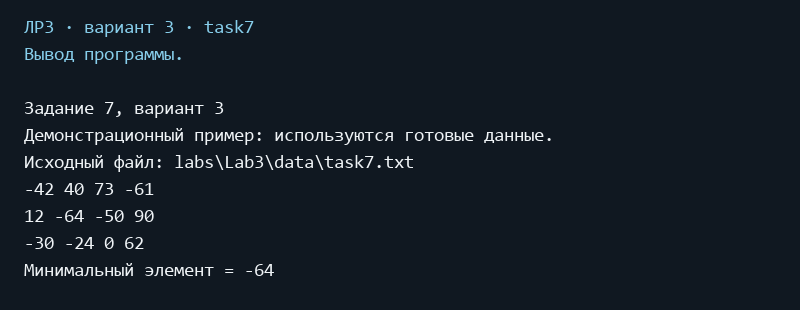

### Ручной ввод и проверка

Пункт 7: пять чисел при двух числах в строке образуют неполную последнюю строку; минимум находится среди всех строк.

| Параметр | Введённые значения |
| --- | --- |
| Количество чисел | 5 |
| Чисел в строке | 2 |

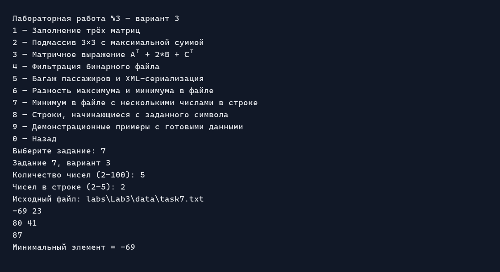

# Задание 8. Текстовый файл

## Задача 8.3. Строки с заданным начальным символом

Для выполнения задания в класс FileTasks был добавлен метод FilterLines.

### Метод отбора строк в FileTasks

FillTextLines записывает исходные строки через StreamWriter. FilterLines читает строки через StreamReader и записывает строку через StreamWriter, если она непустая и её первый символ совпадает с заданным. Регистр учитывается, начальные пробелы не удаляются.

Порядок строк сохраняется. Если совпадений нет, выходной файл будет пустым. Исходный и выходной пути должны различаться, чтобы не перезаписать исходный текст.

**Методы FileTasks**

```csharp
public static void FillTextLines(string path, string[] lines)
{
    ArgumentNullException.ThrowIfNull(lines);
    using StreamWriter writer = new StreamWriter(path, false, Encoding.UTF8);

    foreach (string line in lines)
    {
        writer.WriteLine(line);
    }
}

public static void FilterLines(string source, string destination, char firstCharacter)
{
    ValidateDifferentPaths(source, destination);
    using StreamReader reader = new StreamReader(source, Encoding.UTF8);
    using StreamWriter writer = new StreamWriter(destination, false, Encoding.UTF8);
    string? line = null;

    while ((line = reader.ReadLine()) is not null)
    {
        if (line.Length > 0 && line[0] == firstCharacter)
        {
            writer.WriteLine(line);
        }
    }
}
```

Общий метод ValidateDifferentPaths приведён в задании 4, метод ReadText — в задании 6.

### Условие

Переписать в другой файл строки, начинающиеся с заданного символа.

### Описание задачи

Порядок выполнения примера:

1. В исходный файл записаны строки с разным регистром, пустая строка и строка с начальным пробелом.
2. Метод FilterLines переписал в новый файл строки, начинающиеся с символа «Б».
3. Выведены исходный текст и отобранные строки; порядок строк сохранён.

### Код примера

**Полный код Task8: запуск и пример**

```csharp
using CSharpLabs.Lab3.Common;

namespace CSharpLabs.Lab3.Tasks;

internal static class Task8
{
    public static void RunExample()
    {
        string[] lines = { "Багаж готов", "билет куплен", "", "Борис в пути", " Буква после пробела", "Анна дома" };
        Run(lines, 'Б');
    }

    public static void Run(string[] lines, char firstCharacter)
    {
        string source = Lab3Files.GetDataPath("lines.txt");
        string destination = Lab3Files.GetDataPath("selected_lines.txt");
        FileTasks.FillTextLines(source, lines);
        FileTasks.FilterLines(source, destination, firstCharacter);
        Console.WriteLine($"Исходный файл: {source}");
        Console.Write(FileTasks.ReadText(source));
        Console.WriteLine($"Строки на символ «{firstCharacter}», с учётом регистра: {destination}");
        string result = FileTasks.ReadText(destination);
        if (result.Length == 0)
        {
            Console.WriteLine("(пусто)");
        }
        else
        {
            Console.WriteLine(result);
        }
    }
}
```

### Результат

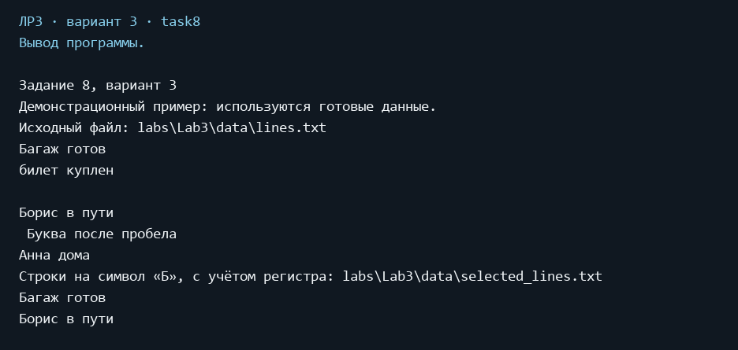

### Ручной ввод и проверка

Пункт 8: из строк «Багаж», «багаж», пустой строки, « Багаж» и «Билет» на символ «Б» выбираются только «Багаж» и «Билет».

| Параметр | Введённые значения |
| --- | --- |
| Начальный символ | Б |
| Количество строк | 5 |
| Строки по порядку | «Багаж», «багаж», пустая строка, « Багаж», «Билет» |

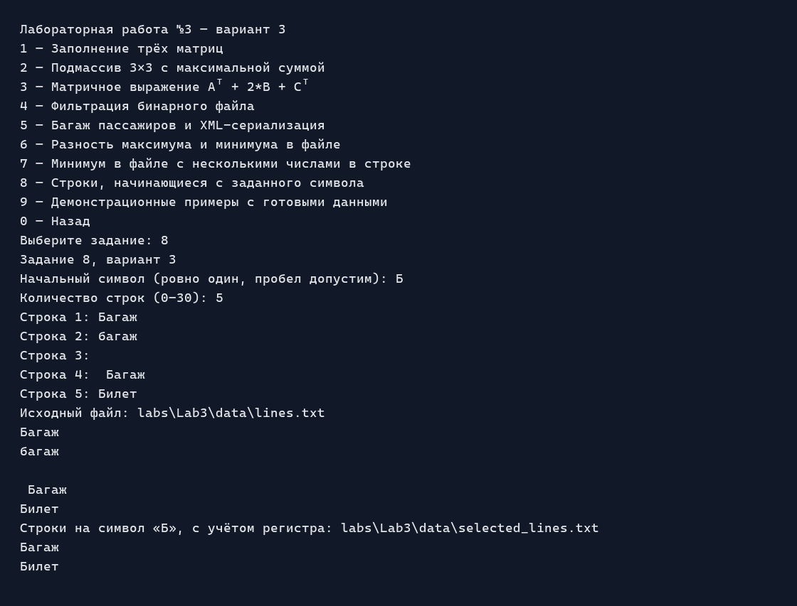

# Ручной ввод данных

Lab3Input читает параметры заданий через общий класс ConsoleInput из CSharpLabs/Common. Если A и C имеют размер n×m, для B задаётся размер m×n. Масса предмета должна быть положительной; порог m может быть любым числом. Делители не могут быть нулевыми. Пустые строки и начальные пробелы текста сохраняются. Элементы матриц читает конструктор Matrix(n, m), заполняя массив по столбцам.

**Полный код Lab3Input**

```csharp
using System.Globalization;
using CSharpLabs.Common;
using CSharpLabs.Lab3.Tasks;

namespace CSharpLabs.Lab3.Common;

internal static class Lab3Input
{
    public static void Run(int task)
    {
        switch (task)
        {
            case 1:
                Task1.Run();
                break;
            case 2:
                Task2.Run(ReadMatrix("Исходная матрица", 3));
                break;
            case 3:
                ReadExpression();
                break;
            case 4:
                int count = ConsoleInput.ReadInt("Количество чисел (0–100): ", 0, 100);
                int m = ReadNonzero("Делитель m: ");
                int n = ReadNonzero("Делитель n: ");
                Task4.Run(count, m, n);
                break;
            case 5:
                Passenger[] passengers = ReadPassengers();
                decimal mass = ReadMass("Порог m, кг: ", false);
                Task5.Run(passengers, mass);
                break;
            case 6:
            case 7:
                int minimumCount = 0;

                if (task == 6)
                {
                    minimumCount = 1;
                }
                else
                {
                    minimumCount = 2;
                }
                int numberCount = ConsoleInput.ReadInt($"Количество чисел ({minimumCount}–100): ", minimumCount, 100);
                int maximumPerLine = Math.Min(10, numberCount);
                int perLine = 0;

                if (task == 6)
                {
                    perLine = 1;
                }
                else
                {
                    perLine = ConsoleInput.ReadInt($"Чисел в строке (2–{maximumPerLine}): ", 2, maximumPerLine);
                }

                if (task == 6)
                {
                    Task6.Run(numberCount);
                }
                else
                {
                    Task7.Run(numberCount, perLine);
                }
                break;
            case 8:
                char firstCharacter = ReadCharacter();
                string[] lines = ReadLines();
                Task8.Run(lines, firstCharacter);
                break;
        }
    }

    private static void ReadExpression()
    {
        int rows = ConsoleInput.ReadInt("Число строк A и C (1–20): ", 1, 20);
        int columns = ConsoleInput.ReadInt("Число столбцов A и C (1–20): ", 1, 20);
        Console.WriteLine("Матрица A, ввод по столбцам:");
        Matrix a = new Matrix(rows, columns);
        Console.WriteLine("Матрица B, размеры обратные размерам A:");
        Matrix b = new Matrix(columns, rows);
        Console.WriteLine("Матрица C:");
        Matrix c = new Matrix(rows, columns);
        Task3.Run(a, b, c);
    }

    private static Passenger[] ReadPassengers()
    {
        int count = ConsoleInput.ReadInt("Количество пассажиров (0–20): ", 0, 20);
        Passenger[] passengers = new Passenger[count];
        string name = string.Empty;
        int itemsCount = 0;
        BaggageItem[] items = Array.Empty<BaggageItem>();
        string itemName = string.Empty;

        for (int i = 0; i < count; i++)
        {
            name = ConsoleInput.ReadRequiredText($"Имя пассажира {i + 1}: ");
            itemsCount = ConsoleInput.ReadInt("Количество единиц багажа (0–20): ", 0, 20);
            items = new BaggageItem[itemsCount];

            for (int j = 0; j < itemsCount; j++)
            {
                itemName = ConsoleInput.ReadRequiredText($"Название единицы {j + 1}: ");
                items[j] = new BaggageItem(itemName, ReadMass("Масса, кг: "));
            }

            passengers[i] = new Passenger(name, items);
        }

        return passengers;
    }

    private static char ReadCharacter()
    {
        string symbol = string.Empty;

        do
        {
            Console.Write("Начальный символ (ровно один, пробел допустим): ");
            symbol = Console.ReadLine() ?? throw new EndOfStreamException();

            if (symbol.Length != 1)
            {
                Console.WriteLine("Введите ровно один символ.");
            }
        }
        while (symbol.Length != 1);

        return symbol[0];
    }

    private static string[] ReadLines()
    {
        int count = ConsoleInput.ReadInt("Количество строк (0–30): ", 0, 30);
        string[] lines = new string[count];

        for (int i = 0; i < count; i++)
        {
            Console.Write($"Строка {i + 1}: ");
            lines[i] = Console.ReadLine() ?? throw new EndOfStreamException();
        }

        return lines;
    }

    private static Matrix ReadMatrix(string title, int minimum = 1)
    {
        Console.WriteLine(title);
        int rows = ConsoleInput.ReadInt($"Число строк ({minimum}–20): ", minimum, 20);
        int columns = ConsoleInput.ReadInt($"Число столбцов ({minimum}–20): ", minimum, 20);
        return new Matrix(rows, columns);
    }

    private static int ReadNonzero(string prompt)
    {
        int value = 0;

        while (true)
        {
            value = ConsoleInput.ReadInt(prompt, int.MinValue, int.MaxValue);

            if (value != 0)
            {
                return value;
            }

            Console.WriteLine("Делитель не должен быть равен нулю.");
        }
    }

    private static decimal ReadMass(string prompt, bool requirePositive = true)
    {
        string text = string.Empty;
        decimal value = 0;

        while (true)
        {
            text = ConsoleInput.ReadRequiredText(prompt).Replace(',', '.');

            if (decimal.TryParse(text, NumberStyles.AllowLeadingSign | NumberStyles.AllowDecimalPoint,
                CultureInfo.InvariantCulture, out value) && (!requirePositive || value > 0))
            {
                return value;
            }

            if (requirePositive)
            {
                Console.WriteLine("Введите положительную массу; дробную часть отделите точкой или запятой.");
            }
            else
            {
                Console.WriteLine("Введите число; дробную часть отделите точкой или запятой.");
            }
        }
    }
}
```

# Проверка интерфейса

При неверном вводе программа повторяет запрос. Завершение ввода приводит к сообщению «Ввод завершён». Проверены размеры матриц, ненулевые делители, положительная масса, количество объектов и ввод ровно одного начального символа.

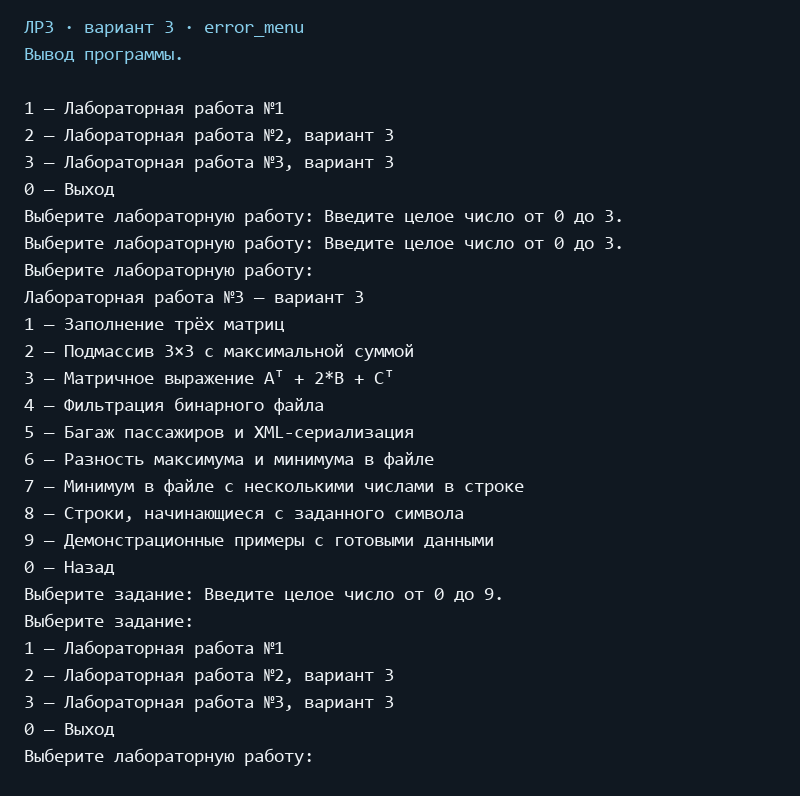

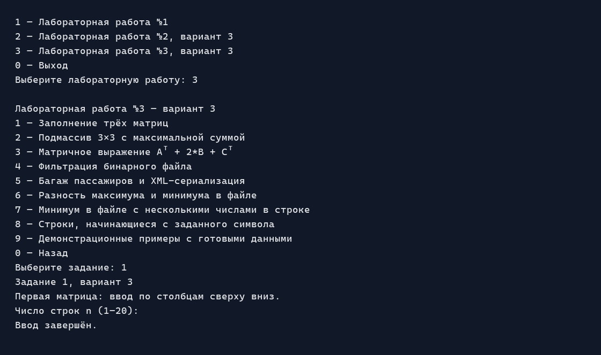

# Вывод

Выполнены восемь заданий варианта 3. Проверены три способа заполнения матриц, поиск блока 3×3, матричное выражение и обработка файлов. Сборка проходит без ошибок и предупреждений. Результат выражения совпадает с приложенной проверкой в MatrixCalc.

Запуск: `dotnet run --project CSharpLabs/CSharpLabs.csproj`, затем пункт 3.

Исходное задание: [lab3_csharp.pdf](lab3_csharp.pdf).
