# Братилов Захар, группа ИТ-1,2. Лабораторная работа №3

Вариант 3. Массивы и файлы. Выполнены задачи варианта 3 из всех восьми заданий в одном проекте .NET 10. Задания 1–3 находятся в классе Matrix, задания 4–8 — в отдельном статическом классе FileTasks.

В главном меню выберите 3. Пункты 1–8 меню ЛР3 запускают воспроизводимые примеры; пункт 9 позволяет ввести параметры и объекты. В демонстрациях используется new Random(3); это случайное заполнение с фиксированным начальным состоянием для повторяемости проверок. Файлы создаются в labs/Lab3/data относительно текущего каталога. Запускать из корня репозитория.

Оформление повторяет структуру отчёта ЛР2: класс, условие, описание, код примера, результат и ручной ввод. Изображения ниже визуализируют настоящий вывод программы, а не интерактивные снимки терминала.

Код не использует автосвойства, LINQ и лямбда-выражения. Применены именование PascalCase/camelCase, поля _camelCase, отступы в четыре пробела и скобки Allman согласно [руководству Microsoft](https://learn.microsoft.com/en-us/dotnet/csharp/fundamentals/coding-style/coding-conventions).


# Задание 1. Заполнение двумерных массивов

## Задача 1.3. Вариант 3

### Условие

Первый массив n×m заполняется с клавиатуры по столбцам сверху вниз. Во втором массиве n×n выше побочной диагонали находятся случайные целые числа [-12; 4565], на диагонали и ниже — [-1024; 1024]. Третий массив заполняется по рисунку для произвольного n.

### Класс и описание задачи

Класс Matrix содержит единственное поле long[,] _values. Три перегруженных конструктора выполняют ввод, случайное и закономерное заполнение. Для побочной диагонали проверяется row + column < size − 1. В третьем конструкторе диагонали обходятся от правого нижнего угла снизу вверх. Незаполненная часть остаётся нулевой. При n=5 получается точный рисунок из задания. Доступ к размерам и элементам реализован явно, без автосвойств.

**Полный код Matrix для заданий 1–3**


```csharp
using System.Globalization;
using System.Text;

namespace CSharpLabs.Lab3;

/// <summary>Целочисленная матрица и операции заданий 1–3.</summary>
public class Matrix
{
    private readonly long[,] _values;

    /// <summary>Вводит прямоугольную матрицу по столбцам сверху вниз.</summary>
    public Matrix(int rows, int columns)
    {
        ValidateDimensions(rows, columns);
        _values = new long[rows, columns];

        for (int column = 0; column < columns; column++)
        {
            for (int row = 0; row < rows; row++)
            {
                _values[row, column] = ConsoleInput.ReadInt(
                    $"Элемент [{row + 1}, {column + 1}]: ", int.MinValue, int.MaxValue);
            }
        }
    }

    /// <summary>Заполняет квадратную матрицу случайными числами по условию.</summary>
    public Matrix(int size, Random random)
    {
        ValidateDimensions(size, size);
        ArgumentNullException.ThrowIfNull(random);
        _values = new long[size, size];

        for (int row = 0; row < size; row++)
        {
            for (int column = 0; column < size; column++)
            {
                _values[row, column] = row + column < size - 1
                    ? random.Next(-12, 4566)
                    : random.Next(-1024, 1025);
            }
        }
    }

    /// <summary>Заполняет нижний правый треугольник по диагоналям от правого нижнего угла.</summary>
    public Matrix(int size)
    {
        ValidateDimensions(size, size);
        _values = new long[size, size];
        long value = 1;

        for (int diagonal = 0; diagonal < size; diagonal++)
        {
            for (int offset = 0; offset <= diagonal; offset++)
            {
                _values[size - 1 - offset, size - 1 - diagonal + offset] = value;
                value++;
            }
        }
    }

    /// <summary>Создаёт независимую копию переданного массива.</summary>
    public Matrix(long[,] values)
    {
        ArgumentNullException.ThrowIfNull(values);
        ValidateDimensions(values.GetLength(0), values.GetLength(1));
        _values = (long[,])values.Clone();
    }

    /// <summary>Количество строк.</summary>
    public int Rows
    {
        get
        {
            return _values.GetLength(0);
        }
    }

    /// <summary>Количество столбцов.</summary>
    public int Columns
    {
        get
        {
            return _values.GetLength(1);
        }
    }

    /// <summary>Возвращает элемент по индексам с нуля.</summary>
    public long this[int row, int column]
    {
        get
        {
            return _values[row, column];
        }
    }

    /// <summary>Находит первый при обходе по строкам блок 3×3 с максимальной суммой.</summary>
    public Matrix FindMaximumBlock(out int top, out int left, out long sum)
    {
        if (Rows < 3 || Columns < 3)
        {
            throw new InvalidOperationException("Для блока 3×3 нужны минимум три строки и три столбца.");
        }

        top = 0;
        left = 0;
        sum = long.MinValue;

        for (int row = 0; row <= Rows - 3; row++)
        {
            for (int column = 0; column <= Columns - 3; column++)
            {
                long current = 0;

                for (int i = 0; i < 3; i++)
                {
                    for (int j = 0; j < 3; j++)
                    {
                        current = checked(current + _values[row + i, column + j]);
                    }
                }

                if (current > sum)
                {
                    sum = current;
                    top = row;
                    left = column;
                }
            }
        }

        long[,] block = new long[3, 3];

        for (int row = 0; row < 3; row++)
        {
            for (int column = 0; column < 3; column++)
            {
                block[row, column] = _values[top + row, left + column];
            }
        }

        return new Matrix(block);
    }

    /// <summary>Транспонирует матрицу.</summary>
    public Matrix Transpose()
    {
        long[,] result = new long[Columns, Rows];

        for (int row = 0; row < Rows; row++)
        {
            for (int column = 0; column < Columns; column++)
            {
                result[column, row] = _values[row, column];
            }
        }

        return new Matrix(result);
    }

    /// <summary>Складывает матрицы одинакового размера.</summary>
    public static Matrix operator +(Matrix first, Matrix second)
    {
        ArgumentNullException.ThrowIfNull(first);
        ArgumentNullException.ThrowIfNull(second);

        if (first.Rows != second.Rows || first.Columns != second.Columns)
        {
            throw new ArgumentException("Размеры слагаемых матриц должны совпадать.");
        }

        long[,] result = new long[first.Rows, first.Columns];

        for (int row = 0; row < first.Rows; row++)
        {
            for (int column = 0; column < first.Columns; column++)
            {
                result[row, column] = checked(first[row, column] + second[row, column]);
            }
        }

        return new Matrix(result);
    }

    /// <summary>Умножает матрицу на целое число слева.</summary>
    public static Matrix operator *(long factor, Matrix matrix)
    {
        ArgumentNullException.ThrowIfNull(matrix);
        long[,] result = new long[matrix.Rows, matrix.Columns];

        for (int row = 0; row < matrix.Rows; row++)
        {
            for (int column = 0; column < matrix.Columns; column++)
            {
                result[row, column] = checked(factor * matrix[row, column]);
            }
        }

        return new Matrix(result);
    }

    /// <summary>Умножает матрицу на целое число справа.</summary>
    public static Matrix operator *(Matrix matrix, long factor)
    {
        return factor * matrix;
    }

    /// <summary>Возвращает таблицу с выравниванием элементов.</summary>
    public override string ToString()
    {
        int width = 1;

        foreach (long value in _values)
        {
            width = Math.Max(width, value.ToString(CultureInfo.InvariantCulture).Length);
        }

        StringBuilder result = new StringBuilder();

        for (int row = 0; row < Rows; row++)
        {
            for (int column = 0; column < Columns; column++)
            {
                if (column > 0)
                {
                    result.Append(' ');
                }

                result.Append(_values[row, column].ToString(CultureInfo.InvariantCulture).PadLeft(width));
            }

            if (row < Rows - 1)
            {
                result.AppendLine();
            }
        }

        return result.ToString();
    }

    private static void ValidateDimensions(int rows, int columns)
    {
        if (rows <= 0 || columns <= 0)
        {
            throw new ArgumentOutOfRangeException(nameof(rows), "Размеры матрицы должны быть положительными.");
        }
    }
}
```

### Код примера

**Вызов из Lab3**


```csharp
private static void RunFilling(bool manual)
{
    Matrix first;
    int size = 5;

    if (manual)
    {
        first = ReadMatrix("Первая матрица");
        size = ConsoleInput.ReadInt("Размер квадратных матриц (1–20): ", 1, 20);
    }
    else
    {
        Console.WriteLine("Ввод по столбцам: 1, 2, 3, 4, 5, 6.");
        first = new Matrix(new long[,] { { 1, 3, 5 }, { 2, 4, 6 } });
    }

    Console.WriteLine("Первая матрица:");
    Console.WriteLine(first);
    Console.WriteLine("Вторая матрица: выше побочной [-12;4565], на ней и ниже [-1024;1024]:");
    Console.WriteLine(new Matrix(size, new Random(3)));
    Console.WriteLine("Третья матрица:");
    Console.WriteLine(new Matrix(size));
}
```

### Результат

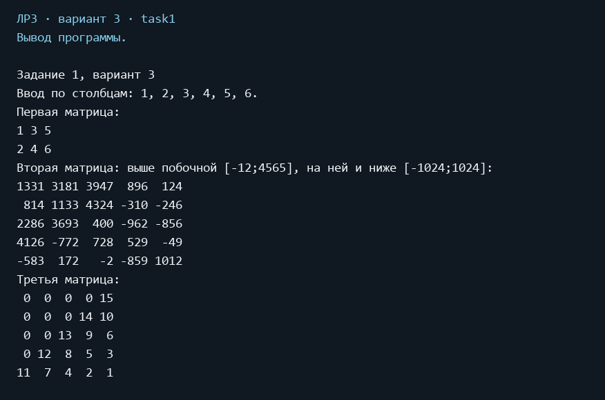

### Ручной ввод и проверка

Пункт 9 → 1: ввод 1–6 по столбцам в массив 2×3 даёт строки 1 3 5 и 2 4 6; для n=1 закономерная матрица содержит 1.

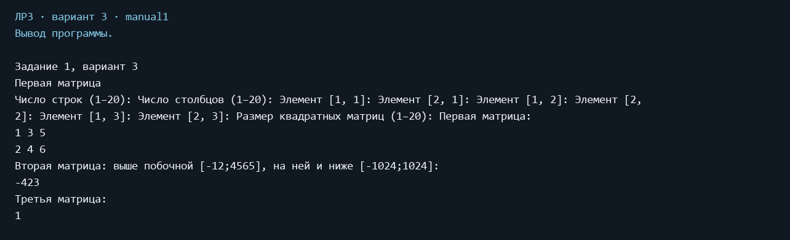


# Задание 2. Работа с двумерными массивами

## Задача 2.3. Вариант 3

### Условие

В массиве n×m найти подмассив 3×3 с максимальной суммой. Размеры могут быть не кратны трём.

### Класс и описание задачи

FindMaximumBlock перебирает все допустимые левые верхние углы, включая перекрывающиеся блоки и последние строки/столбцы. Для каждого блока суммируются девять элементов. Начальное значение long.MinValue позволяет обрабатывать полностью отрицательные массивы. При равенстве выбирается первый блок при обходе по строкам. Возвращаются блок, его сумма и координаты; на экран координаты выводятся с единицы. Сложность O(nm), дополнительная память для результата постоянна.

### Код примера

**Вызов из Lab3**


```csharp
private static void RunMaximumBlock(bool manual)
{
    Matrix matrix = manual ? ReadMatrix("Исходная матрица", 3) : new Matrix(new long[,]
    {
        { 1, 2, 3, 4, 5 },
        { 6, 7, 8, 9, 10 },
        { 11, 12, 13, 14, 15 },
        { 16, 17, 18, 19, 20 }
    });
    Console.WriteLine("Исходная матрица:");
    Console.WriteLine(matrix);
    Matrix block = matrix.FindMaximumBlock(out int row, out int column, out long sum);
    Console.WriteLine($"Начало блока: строка {row + 1}, столбец {column + 1}; сумма = {sum}.");
    Console.WriteLine(block);
}
```

### Результат

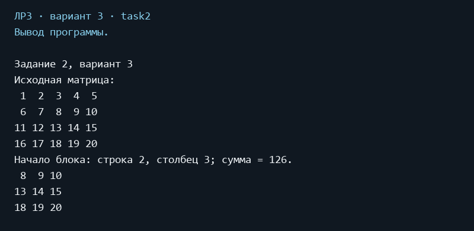

### Ручной ввод и проверка

Пункт 9 → 2: отрицательный массив 3×4 даёт максимальную сумму −63 в блоке с первого ряда, второго столбца. Проверяется крайний правый блок.

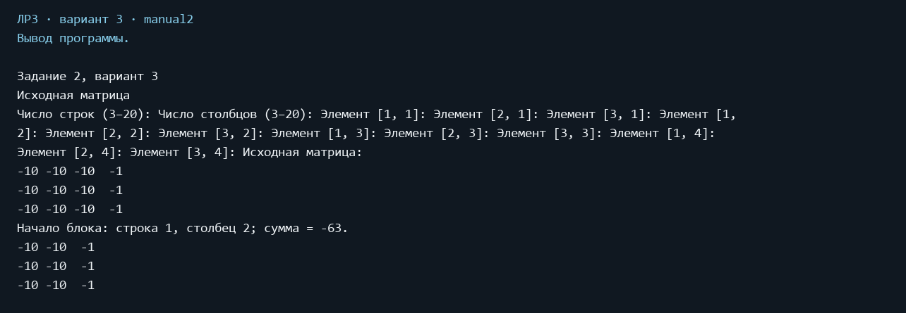


# Задание 3. Работа с двумерными массивами как с матрицами

## Задача 3.3. Вариант 3

### Условие

Вычислить Aᵀ + 2B + Cᵀ, перегрузив необходимые операторы. Вывод матриц реализовать через ToString. Приложить снимок проверки в онлайн-калькуляторе.

### Класс и описание задачи

Transpose меняет строки и столбцы местами. Перегружены + для двух матриц и * для числа и матрицы с обеих сторон. Выражение вычисляется непосредственно как a.Transpose() + 2 * b + c.Transpose(). Операнды сохраняются. Размер B должен совпадать с размером транспонированных A и C; квадратность не требуется. Арифметика checked обнаруживает переполнение long.

### Код примера

**Вызов из Lab3**


```csharp
private static void RunExpression(bool manual)
{
    Matrix a;
    Matrix b;
    Matrix c;

    if (manual)
    {
        int rows = ConsoleInput.ReadInt("Число строк A и C (1–20): ", 1, 20);
        int columns = ConsoleInput.ReadInt("Число столбцов A и C (1–20): ", 1, 20);
        Console.WriteLine("Матрица A, ввод по столбцам:");
        a = new Matrix(rows, columns);
        Console.WriteLine("Матрица B, размеры обратные размерам A:");
        b = new Matrix(columns, rows);
        Console.WriteLine("Матрица C:");
        c = new Matrix(rows, columns);
    }
    else
    {
        a = new Matrix(new long[,] { { 1, 2 }, { 3, 4 } });
        b = new Matrix(new long[,] { { 5, 6 }, { 7, 8 } });
        c = new Matrix(new long[,] { { 9, 10 }, { 11, 12 } });
    }

    Console.WriteLine($"A:\n{a}\nB:\n{b}\nC:\n{c}");
    Matrix result = a.Transpose() + 2 * b + c.Transpose();
    Console.WriteLine($"Aᵀ + 2*B + Cᵀ:\n{result}");
}
```

### Результат

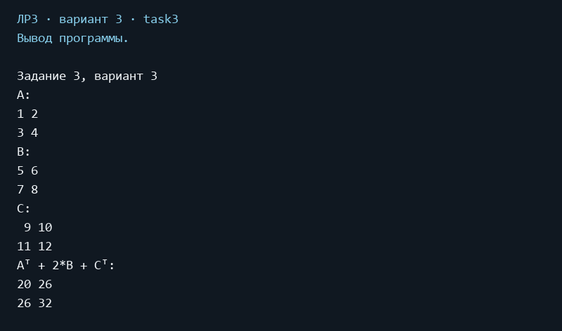

### Ручной ввод и проверка

Пункт 9 → 3: A и C размера 1×2 и B размера 2×1 дают прямоугольный результат с элементами 12 и 16.

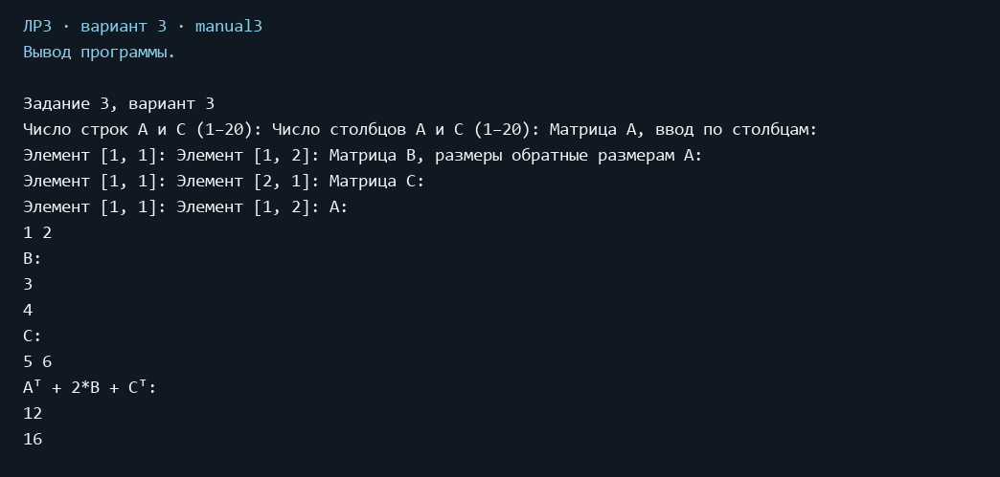

### Независимая проверка выражения

Для демонстрации A=[[1,2],[3,4]], B=[[5,6],[7,8]], C=[[9,10],[11,12]]. Aᵀ=[[1,3],[2,4]], 2B=[[10,12],[14,16]], Cᵀ=[[9,11],[10,12]]. Поэлементная сумма равна [[20,26],[26,32]] и совпадает с программой.

Проверка в [онлайн-калькуляторе MatrixCalc](https://matrixcalc.org/ru/): выражение `{{1,2},{3,4}}^T+2*{{5,6},{7,8}}+{{9,10},{11,12}}^T` даёт тот же результат [[20,26],[26,32]].

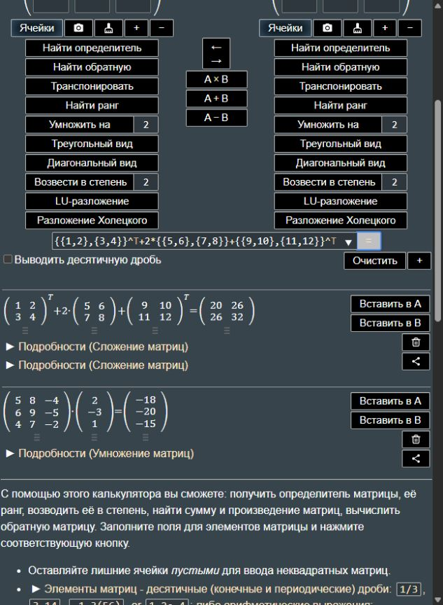


# Задание 4. Бинарные файлы

## Задача 4.3. Вариант 3

### Условие

Получить в новом бинарном файле все компоненты исходного, которые делятся на m и не делятся на n. Исходный файл заполнить случайными числами отдельным методом.

### Класс и описание задачи

FillBinaryNumbers записывает случайные Int32 через BinaryWriter. FilterBinaryNumbers последовательно читает числа через BinaryReader и записывает подходящие в новый файл, сохраняя порядок и повторы. Условие: value % m == 0 && value % n != 0. Нулевые делители запрещены; остаток вычисляется после расширения до long для случая int.MinValue и −1. Ноль не проходит фильтр, поскольку кратен обоим делителям.

**Методы FileTasks**


```csharp
public static void FillBinaryNumbers(string path, int count, Random random)
{
    ArgumentOutOfRangeException.ThrowIfNegative(count);
    ArgumentNullException.ThrowIfNull(random);
    using BinaryWriter writer = new BinaryWriter(File.Create(path));

    for (int i = 0; i < count; i++)
    {
        writer.Write(random.Next(-100, 101));
    }
}

public static void FilterBinaryNumbers(string source, string destination, int m, int n)
{
    ValidateDifferentPaths(source, destination);

    if (m == 0 || n == 0)
    {
        throw new ArgumentException("Делители m и n не должны быть равны нулю.");
    }

    using BinaryReader reader = new BinaryReader(File.OpenRead(source));

    if (reader.BaseStream.Length % sizeof(int) != 0)
    {
        throw new InvalidDataException("Бинарный файл должен содержать целые Int32.");
    }

    using BinaryWriter writer = new BinaryWriter(File.Create(destination));

    while (reader.BaseStream.Position < reader.BaseStream.Length)
    {
        int value = reader.ReadInt32();

        // Расширение до long исключает переполнение int.MinValue % -1.
        if ((long)value % m == 0 && (long)value % n != 0)
        {
            writer.Write(value);
        }
    }
}

public static string ReadBinaryNumbers(string path)
{
    using BinaryReader reader = new BinaryReader(File.OpenRead(path));
    StringBuilder result = new StringBuilder();

    while (reader.BaseStream.Position < reader.BaseStream.Length)
    {
        if (result.Length > 0)
        {
            result.Append(' ');
        }

        result.Append(reader.ReadInt32());
    }

    return result.Length == 0 ? "(пусто)" : result.ToString();
}

private static void ValidateDifferentPaths(string source, string destination)
{
    if (string.Equals(Path.GetFullPath(source), Path.GetFullPath(destination),
        StringComparison.OrdinalIgnoreCase))
    {
        throw new ArgumentException("Исходный и выходной файлы должны различаться.");
    }
}
```

### Код примера

**Вызов из Lab3**


```csharp
private static void RunBinary(bool manual)
{
    int count = manual ? ConsoleInput.ReadInt("Количество чисел (0–100): ", 0, 100) : 20;
    int m = manual ? ReadNonzero("Делитель m: ") : 3;
    int n = manual ? ReadNonzero("Делитель n: ") : 2;
    string source = DataPath("numbers.bin");
    string destination = DataPath("filtered.bin");
    FileTasks.FillBinaryNumbers(source, count, new Random(3));
    FileTasks.FilterBinaryNumbers(source, destination, m, n);
    Console.WriteLine($"Исходный файл: {source}\n{FileTasks.ReadBinaryNumbers(source)}");
    Console.WriteLine($"m = {m}, n = {n}");
    Console.WriteLine($"Результат: {destination}\n{FileTasks.ReadBinaryNumbers(destination)}");
}
```

### Результат

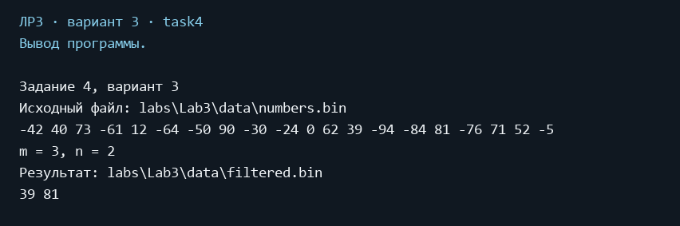

### Ручной ввод и проверка

Пункт 9 → 4: пустой исходный файл создаёт пустой результат; нулевой делитель отклоняется с повторным запросом.

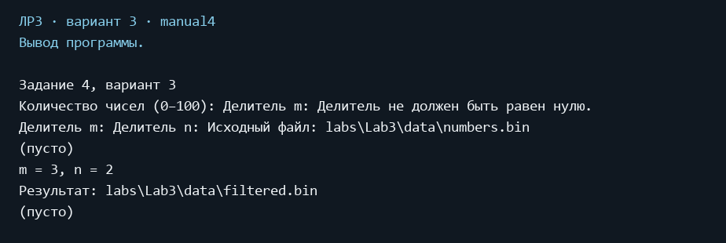


# Задание 5. Бинарные файлы и структуры

## Задача 5.3. Вариант 3

### Условие

Багаж пассажира — массив структур с названием и массой единицы багажа. Выяснить, имеется ли пассажир с одной единицей багажа массой менее m кг. Заполнение файла выполнить отдельным методом с обязательной XML-сериализацией.

### Класс и описание задачи

BaggageItem и Passenger являются struct. Passenger содержит массив BaggageItem. Все свойства имеют явные поля. FillPassengers сериализует Passenger[] с помощью XmlSerializer в XML UTF-8, затем BinaryWriter записывает длину XML (Int32) и его байты в passengers.bin. Такой контейнер совмещает требование бинарного файла с обязательной XML-сериализацией; он не является побайтовой копией памяти struct. ReadPassengers читает длину, проверяет её и десериализует XML. Проверка выполняется после чтения файла: единица должна быть ровно одна, её масса строго меньше m. Масса хранится в decimal.

**Полный код BaggageItem**


```csharp
namespace CSharpLabs.Lab3;

/// <summary>Единица багажа, сериализуемая в XML.</summary>
public struct BaggageItem
{
    private string? _name;
    private decimal _mass;

    /// <summary>Создаёт единицу багажа с названием и массой в килограммах.</summary>
    public BaggageItem(string name, decimal mass)
    {
        _name = null;
        _mass = 0;
        Name = name;
        Mass = mass;
    }

    /// <summary>Название единицы багажа.</summary>
    public string Name
    {
        get
        {
            return _name ?? string.Empty;
        }
        set
        {
            ArgumentException.ThrowIfNullOrWhiteSpace(value);
            _name = value.Trim();
        }
    }

    /// <summary>Положительная масса в килограммах.</summary>
    public decimal Mass
    {
        get
        {
            return _mass;
        }
        set
        {
            if (value <= 0)
            {
                throw new ArgumentOutOfRangeException(nameof(value), "Масса должна быть положительной.");
            }

            _mass = value;
        }
    }
}
```

**Полный код Passenger**


```csharp
namespace CSharpLabs.Lab3;

/// <summary>Пассажир и массив единиц его багажа для XML-сериализации.</summary>
public struct Passenger
{
    private string? _name;
    private BaggageItem[]? _items;

    /// <summary>Создаёт запись пассажира.</summary>
    public Passenger(string name, BaggageItem[] items)
    {
        _name = null;
        _items = null;
        Name = name;
        Items = items;
    }

    /// <summary>Имя пассажира.</summary>
    public string Name
    {
        get
        {
            return _name ?? string.Empty;
        }
        set
        {
            ArgumentException.ThrowIfNullOrWhiteSpace(value);
            _name = value.Trim();
        }
    }

    /// <summary>Массив единиц багажа; пустой массив означает отсутствие багажа.</summary>
    public BaggageItem[] Items
    {
        get
        {
            return _items ?? Array.Empty<BaggageItem>();
        }
        set
        {
            ArgumentNullException.ThrowIfNull(value);
            _items = value;
        }
    }
}
```

**Методы FileTasks**


```csharp
public static void FillPassengers(string path, Passenger[] passengers)
{
    ArgumentNullException.ThrowIfNull(passengers);
    XmlSerializer serializer = new XmlSerializer(typeof(Passenger[]));
    using MemoryStream xml = new MemoryStream();
    serializer.Serialize(xml, passengers);
    byte[] data = xml.ToArray();
    using BinaryWriter writer = new BinaryWriter(File.Create(path));
    writer.Write(data.Length);
    writer.Write(data);
}

public static Passenger[] ReadPassengers(string path)
{
    using BinaryReader reader = new BinaryReader(File.OpenRead(path));
    int length = reader.ReadInt32();

    if (length < 0 || length != reader.BaseStream.Length - sizeof(int))
    {
        throw new InvalidDataException("Повреждена длина XML в бинарном файле.");
    }

    using MemoryStream xml = new MemoryStream(reader.ReadBytes(length));
    XmlSerializer serializer = new XmlSerializer(typeof(Passenger[]));
    return (Passenger[])(serializer.Deserialize(xml)
        ?? throw new InvalidDataException("В файле нет массива пассажиров."));
}

public static bool HasLightSingleBaggage(string path, decimal m)
{
    ArgumentOutOfRangeException.ThrowIfNegativeOrZero(m);
    Passenger[] passengers = ReadPassengers(path);

    foreach (Passenger passenger in passengers)
    {
        if (passenger.Items.Length == 1 && passenger.Items[0].Mass < m)
        {
            return true;
        }
    }

    return false;
}
```

### Код примера

**Вызов из Lab3**


```csharp
private static void RunPassengers(bool manual)
{
    Passenger[] passengers =
    {
        new Passenger("Анна", new[] { new BaggageItem("Сумка", 4) }),
        new Passenger("Борис", new[] { new BaggageItem("Чемодан", 12), new BaggageItem("Коробка", 2) }),
        new Passenger("Вера", new[] { new BaggageItem("Рюкзак", 5) })
    };
    decimal m = 5;

    if (manual)
    {
        int count = ConsoleInput.ReadInt("Количество пассажиров (0–20): ", 0, 20);
        passengers = new Passenger[count];

        for (int i = 0; i < count; i++)
        {
            string name = ConsoleInput.ReadRequiredText($"Имя пассажира {i + 1}: ");
            int itemsCount = ConsoleInput.ReadInt("Количество единиц багажа (0–20): ", 0, 20);
            BaggageItem[] items = new BaggageItem[itemsCount];

            for (int j = 0; j < itemsCount; j++)
            {
                string itemName = ConsoleInput.ReadRequiredText($"Название единицы {j + 1}: ");
                items[j] = new BaggageItem(itemName, ReadMass("Масса, кг: "));
            }

            passengers[i] = new Passenger(name, items);
        }

        m = ReadMass("Порог m, кг: ");
    }

    string path = DataPath("passengers.bin");
    FileTasks.FillPassengers(path, passengers);
    Console.WriteLine($"Файл: {path}; XML-сериализация массива структур, затем чтение файла.");

    foreach (Passenger passenger in FileTasks.ReadPassengers(path))
    {
        Console.Write($"{passenger.Name}: {passenger.Items.Length} ед.");

        foreach (BaggageItem item in passenger.Items)
        {
            Console.Write($"; {item.Name} — {item.Mass} кг");
        }

        Console.WriteLine();
    }

    bool found = FileTasks.HasLightSingleBaggage(path, m);
    Console.WriteLine($"Одна единица багажа массой менее {m} кг: {(found ? "Да" : "Нет")}");
}
```

### Результат

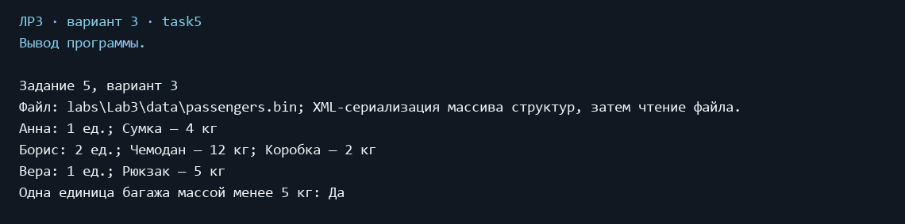

### Ручной ввод и проверка

Пункт 9 → 5: отрицательная масса отклоняется. Для одного предмета массой 5 кг и m=5 результат «Нет»: неравенство строгое. Дроби принимаются с точкой или запятой.

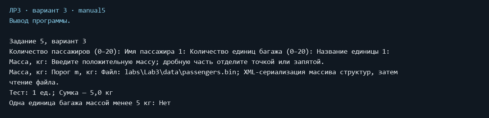


# Задание 6. Текстовые файлы: одно число в строке

## Задача 6.3. Вариант 3

### Условие

В текстовом файле целые числа записаны по одному в строке. Найти разность максимального и минимального элементов. Случайное заполнение — отдельным методом.

### Класс и описание задачи

FillTextNumbers с perLine=1 заполняет исходный файл случайными числами. FindRange читает файл построчно, поддерживая минимум и максимум. Разность вычисляется в long, поэтому для int.MinValue и int.MaxValue получается 4294967295 без переполнения. Пустой файл отклоняется, для одного числа результат равен нулю.

**Методы FileTasks**


```csharp
public static void FillTextNumbers(string path, int count, int perLine, Random random)
{
    ArgumentOutOfRangeException.ThrowIfNegative(count);
    ArgumentOutOfRangeException.ThrowIfNegativeOrZero(perLine);
    ArgumentNullException.ThrowIfNull(random);
    using StreamWriter writer = new StreamWriter(path, false, Encoding.UTF8);

    for (int i = 0; i < count; i++)
    {
        writer.Write(random.Next(-100, 101).ToString(CultureInfo.InvariantCulture));

        if ((i + 1) % perLine == 0 || i == count - 1)
        {
            writer.WriteLine();
        }
        else
        {
            writer.Write(' ');
        }
    }
}

public static long FindRange(string path)
{
    using StreamReader reader = new StreamReader(path);
    string? line = reader.ReadLine();

    if (line is null)
    {
        throw new InvalidDataException("В файле нет чисел.");
    }

    int minimum = int.Parse(line, CultureInfo.InvariantCulture);
    int maximum = minimum;

    while ((line = reader.ReadLine()) is not null)
    {
        int value = int.Parse(line, CultureInfo.InvariantCulture);
        minimum = Math.Min(minimum, value);
        maximum = Math.Max(maximum, value);
    }

    return (long)maximum - minimum;
}
```

### Код примера

**Вызов из Lab3**


```csharp
private static void RunTextNumbers(int task, bool manual)
{
    int count = manual ? ConsoleInput.ReadInt("Количество чисел (1–100): ", 1, 100) : 12;
    int perLine = task == 6 ? 1 : 4;

    if (manual && task == 7)
    {
        perLine = ConsoleInput.ReadInt("Чисел в строке (2–10): ", 2, 10);
    }

    string path = DataPath($"task{task}.txt");
    FileTasks.FillTextNumbers(path, count, perLine, new Random(3));
    Console.WriteLine($"Исходный файл: {path}");
    Console.Write(File.ReadAllText(path));

    if (task == 6)
    {
        Console.WriteLine($"Максимум − минимум = {FileTasks.FindRange(path)}");
    }
    else
    {
        Console.WriteLine($"Минимальный элемент = {FileTasks.FindMinimum(path)}");
    }
}
```

### Результат

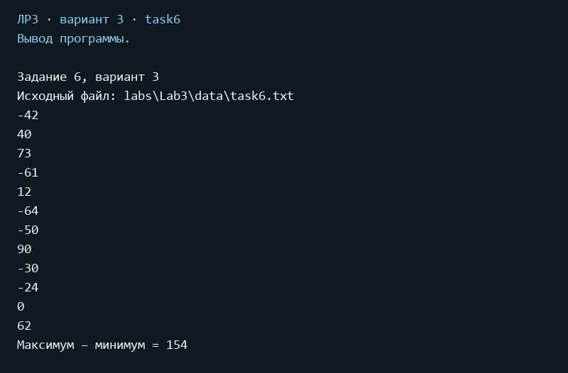

### Ручной ввод и проверка

Пункт 9 → 6: файл из одного числа даёт разность 0.

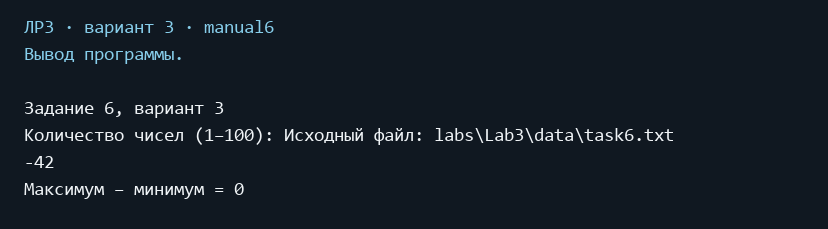


# Задание 7. Текстовые файлы: несколько чисел в строке

## Задача 7.3. Вариант 3

### Условие

В текстовом файле целые числа записаны по несколько в строке. Найти минимальный элемент. Случайное заполнение — отдельным методом.

### Класс и описание задачи

FillTextNumbers записывает по четыре числа в строке в демонстрации; последняя строка может быть неполной. FindMinimum читает строки и разбивает их по пробельным символам. Пробелы, табуляции и пустые строки обрабатываются. При отсутствии чисел выдаётся ошибка. Используются обычные циклы, LINQ отсутствует.

**Методы FileTasks**


```csharp
public static int FindMinimum(string path)
{
    int minimum = int.MaxValue;
    bool found = false;

    foreach (string line in File.ReadLines(path))
    {
        string[] tokens = line.Split((char[]?)null, StringSplitOptions.RemoveEmptyEntries);

        foreach (string token in tokens)
        {
            minimum = Math.Min(minimum, int.Parse(token, CultureInfo.InvariantCulture));
            found = true;
        }
    }

    if (!found)
    {
        throw new InvalidDataException("В файле нет чисел.");
    }

    return minimum;
}
```

Метод заполнения FillTextNumbers приведён в задании 6; здесь perLine > 1.

### Код примера

**Вызов из Lab3**


```csharp
private static void RunTextNumbers(int task, bool manual)
{
    int count = manual ? ConsoleInput.ReadInt("Количество чисел (1–100): ", 1, 100) : 12;
    int perLine = task == 6 ? 1 : 4;

    if (manual && task == 7)
    {
        perLine = ConsoleInput.ReadInt("Чисел в строке (2–10): ", 2, 10);
    }

    string path = DataPath($"task{task}.txt");
    FileTasks.FillTextNumbers(path, count, perLine, new Random(3));
    Console.WriteLine($"Исходный файл: {path}");
    Console.Write(File.ReadAllText(path));

    if (task == 6)
    {
        Console.WriteLine($"Максимум − минимум = {FileTasks.FindRange(path)}");
    }
    else
    {
        Console.WriteLine($"Минимальный элемент = {FileTasks.FindMinimum(path)}");
    }
}
```

### Результат

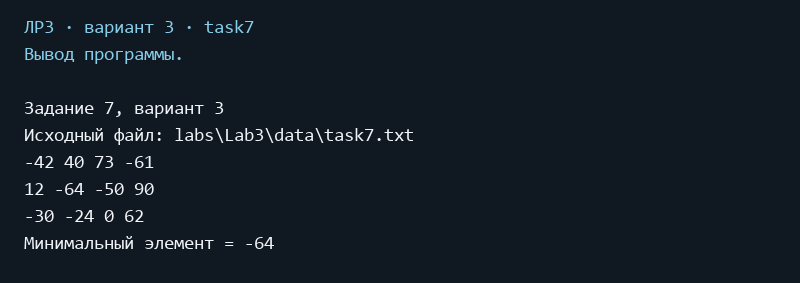

### Ручной ввод и проверка

Пункт 9 → 7: пять чисел при двух числах в строке образуют неполную последнюю строку; минимум находится среди всех строк.

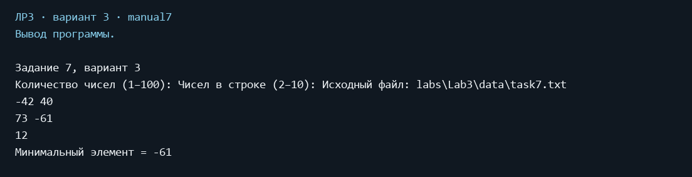


# Задание 8. Текстовый файл

## Задача 8.3. Вариант 3

### Условие

Переписать в другой файл строки, начинающиеся с заданного символа.

### Класс и описание задачи

FilterLines последовательно читает UTF-8 текст. Непустая строка проходит фильтр, если первый символ равен заданному. Регистр учитывается, пробелы в начале не удаляются. Порядок подходящих строк сохраняется. При отсутствии совпадений создаётся пустой выходной файл. Исходный и выходной пути должны различаться.

**Методы FileTasks**


```csharp
public static void FilterLines(string source, string destination, char firstCharacter)
{
    ValidateDifferentPaths(source, destination);
    using StreamReader reader = new StreamReader(source);
    using StreamWriter writer = new StreamWriter(destination, false, Encoding.UTF8);
    string? line;

    while ((line = reader.ReadLine()) is not null)
    {
        if (line.Length > 0 && line[0] == firstCharacter)
        {
            writer.WriteLine(line);
        }
    }
}
```

Общий метод ValidateDifferentPaths приведён в задании 4.

### Код примера

**Вызов из Lab3**


```csharp
private static void RunTextLines(bool manual)
{
    string[] lines = { "Багаж готов", "билет куплен", "", "Борис в пути", " Буква после пробела", "Анна дома" };
    char firstCharacter = 'Б';

    if (manual)
    {
        string symbol;

        do
        {
            Console.Write("Начальный символ (ровно один, пробел допустим): ");
            symbol = Console.ReadLine() ?? throw new EndOfStreamException();

            if (symbol.Length != 1)
            {
                Console.WriteLine("Введите ровно один символ.");
            }
        }
        while (symbol.Length != 1);

        firstCharacter = symbol[0];
        int count = ConsoleInput.ReadInt("Количество строк (0–30): ", 0, 30);
        lines = new string[count];

        for (int i = 0; i < count; i++)
        {
            Console.Write($"Строка {i + 1}: ");
            lines[i] = Console.ReadLine() ?? throw new EndOfStreamException();
        }
    }

    string source = DataPath("lines.txt");
    string destination = DataPath("selected_lines.txt");
    File.WriteAllLines(source, lines, Encoding.UTF8);
    FileTasks.FilterLines(source, destination, firstCharacter);
    Console.WriteLine($"Исходный файл: {source}");
    Console.Write(File.ReadAllText(source));
    Console.WriteLine($"Строки на символ «{firstCharacter}», с учётом регистра: {destination}");
    string result = File.ReadAllText(destination);
    Console.WriteLine(result.Length == 0 ? "(пусто)" : result);
}
```

### Результат

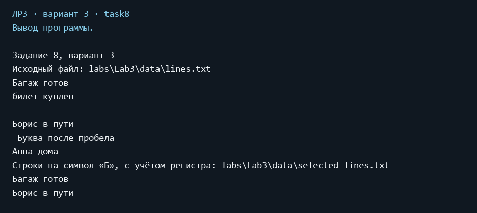

### Ручной ввод и проверка

Пункт 9 → 8: из строк «Багаж», «багаж», пустой строки, « Багаж» и «Билет» на символ «Б» выбираются только «Багаж» и «Билет».

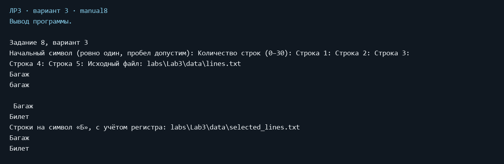


# Проверка интерфейса и граничных случаев

Неверные пункты меню вызывают повторный запрос. Завершение потока ввода корректно завершает программу. В ручном режиме проверяются размеры матриц, ненулевые делители, положительная масса, количество объектов и длина символа.

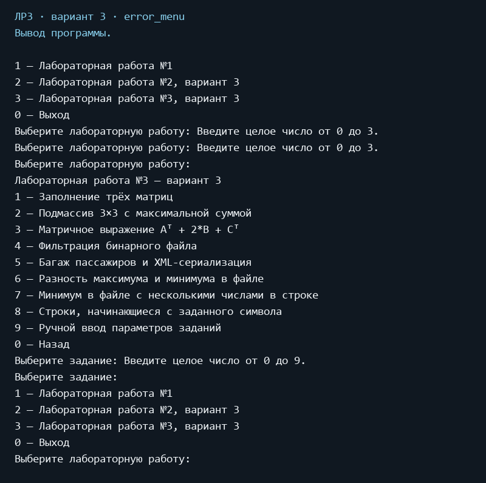

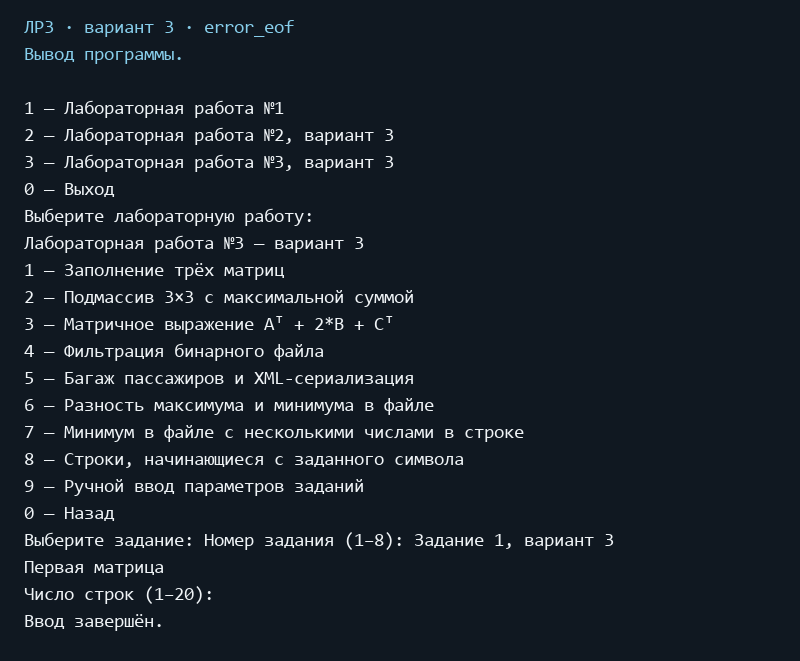

# Вывод

Реализованы восемь задач варианта 3. Использованы двумерный массив, конструкторы, перегрузка операторов, структуры, бинарные и текстовые потоки, XML-сериализация. Сборка проходит без ошибок и предупреждений. Результат задания 3 подтверждён настоящим снимком онлайн-калькулятора MatrixCalc.

Запуск: `dotnet run --project CSharpLabs/CSharpLabs.csproj`, затем пункт 3.

Исходное задание: [lab3_csharp.pdf](lab3_csharp.pdf).
