# Лабораторная работа №4. Вариант 3

**Тема:** коллекции и перегрузка операторов. [Условие работы](lab4_csharp.pdf).

Задания 1–5 реализованы статическими методами класса [CollectionTasks](../../CSharpLabs/Lab4/CollectionTasks.cs). Задания 6–7 используют класс [Point](../../Lab4.Points/Point.cs) в отдельном проекте. В решении не используются автосвойства, LINQ и лямбда-выражения.

## Задания 1–5. Коллекции

| Задание | Решение | Пример |
| --- | --- | --- |
| 1. `List` | Два индекса последовательно обходят отсортированные списки. На каждом шаге в результат добавляется меньший из текущих элементов. После слияния результат заменяет содержимое `L1`. Повторы сохраняются. Время `O(n + m)`. | `[-2, 1, 1, 5]` и `[-3, 1, 4, 9]` → `[-3, -2, 1, 1, 1, 4, 5, 9]`. |
| 2. `LinkedList` | Для каждого внутреннего узла сравниваются значения предыдущего и следующего. У крайних элементов нет двух соседей. | `[1, 2, 1, 2, 1]` → `3` элемента. |
| 3. `HashSet` | `IntersectWith` находит блюда, заказанные всеми; `UnionWith` — хотя бы одним посетителем. `ExceptWith` вычитает из объединения пересечение (заказали некоторые), а из меню — объединение (не заказал никто). При отсутствии посетителей все блюда относятся к последней группе. | Два заказа: «Борщ; Салат» и «борщ». Все — борщ, некоторые — салат, никто — компот. |
| 4. `HashSet` | UTF-8 файл читается построчно. Словом считается непрерывная последовательность русских букв. Регистр не учитывается. Множество убирает повторы внутри каждого слова. `ExceptWith` исключает из всех встреченных согласных те, которые были в нескольких словах. Результат выводится по порядку букв в алфавите. | «Кукушка, кот и ёж.» → `ж, т, ш`. Буква `к` встречается в двух словах. |
| 5. `Dictionary` | Строки файла читаются один раз. Словарь сопоставляет каждой сумме список участников. Сумма от 0 до 40, поэтому достаточно проверить до 41 ключа по убыванию. Группы с равными баллами добавляются целиком, пока не выбраны как минимум трое. | При суммах `30, 28, 22, 22, 10` выводятся первые четыре участника. |

В задании 5 чтение и группировка занимают `O(N + 41)` времени при ограниченной длине строк. Дополнительная память — `O(N)`: при одинаковых баллах могут пройти все `N` участников. Сортировка не нужна. Метод `FillSportsFile` отдельно формирует исходный файл по введённым данным. Первая строка содержит число участников `N` от 0 до 100, следующие `N` строк имеют вид `Фамилия Имя Балл1 Балл2 Балл3 Балл4`. Каждый балл — целое число от 0 до 10.

### Примеры работы заданий 1–5

Изображения показывают вывод программы при выборе пункта `6` и при ручном вводе. Введённые значения видны рядом с приглашениями; текст запусков сохранён в `screenshots/logs`.

**Задание 1. Слияние списков.** В готовом примере повторяющиеся значения сохраняются. При ручном вводе оба нуля также остаются в результате.

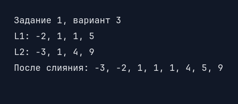

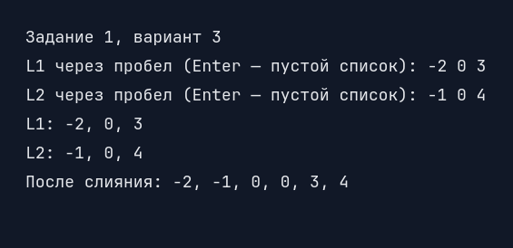

**Задание 2. Равные соседи.** В готовом списке подходят три внутренних узла. В ручном примере `[1, 2, 1, 3, 1]` подходят два.

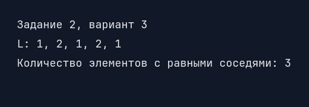

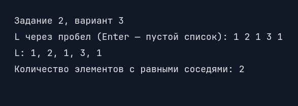

**Задание 3. Заказы в кафе.** Ручная проверка с тремя посетителями показывает все три категории блюд: борщ заказали все, салат и чай — часть посетителей, компот — никто.

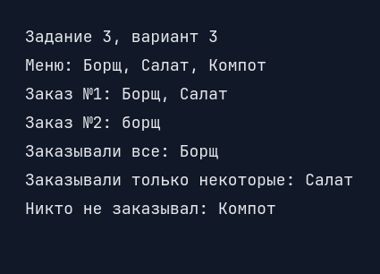

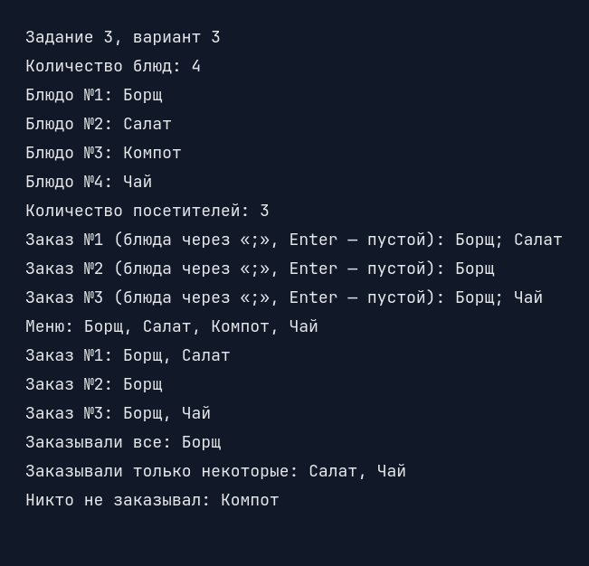

**Задание 4. Согласные.** Для готовой строки результат — `ж, т, ш`. В ручной проверке программа читает [текстовый файл](data/example_consonants.txt) «Мама, мир и дом.» и находит `д, р`.

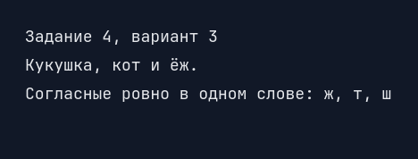

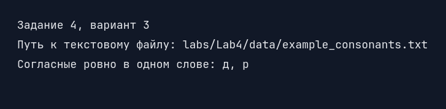

**Задание 5. Лучшие участники.** В обоих примерах на третьем месте равенство баллов, поэтому выведены четыре участника.

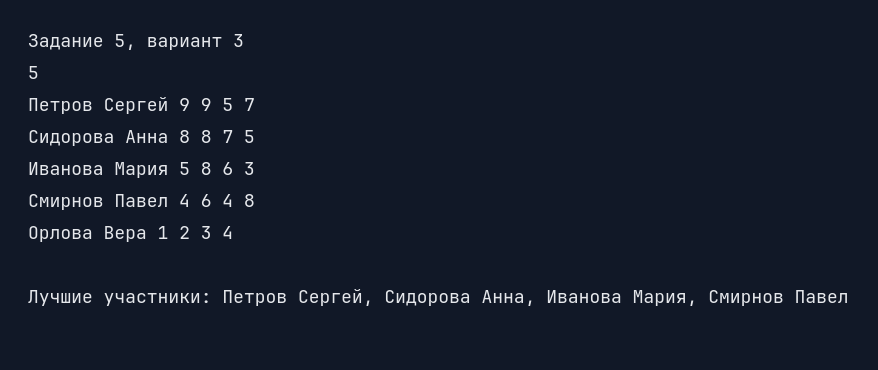

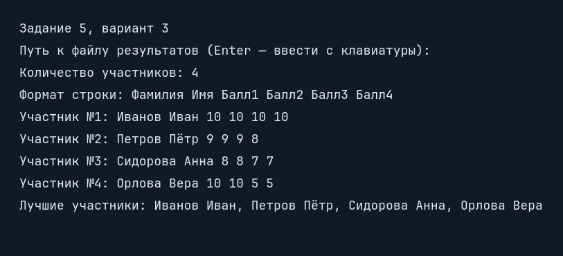

## Задания 6–7. Класс Point

Два закрытых поля хранят координаты типа `double`. Свойства `X` и `Y` проверяют, что значения конечны. Конструктор без параметров создаёт точку `(0; 0)`, конструктор с параметрами принимает координаты. `ToString()` выводит обе координаты. `DistanceTo` вычисляет евклидово расстояние: `√((x₁ − x₂)² + (y₁ − y₂)²)`.

Для `A = (-2.75; 2)` и `B = (0.25; 6)`:

| Операция | Результат |
| --- | --- |
| `A.DistanceTo(B)` | `5` |
| `++A` | `(-1.75; 2)` |
| `--A` | `(-3.75; 2)` |
| `(int)A` | `-2`: дробная часть отбрасывается к нулю |
| Неявное приведение `A` к `double` | `2`: значение `Y` |
| `A + B` | `5`: расстояние между точками |
| `A + 3` и `3 + A` | `(0.25; 2)` |

Каждая строка использует исходную `A`. Операторы смещения создают новую точку; `++` и `--` присваивают её переменной, не меняя объект, на который могли ссылаться другие переменные. Если целая часть `X` вне диапазона `int`, программа сообщает об ошибке приведения и продолжает показ остальных операций.

### Примеры работы заданий 6–7

**Задание 6. Класс Point.** Готовый пример показывает оба конструктора, изменение свойств и расстояние между `A = (-2.75; 2)` и `B = (0.25; 6)`. При ручном вводе для `A = (3; 4)` и `B = (0; 0)` расстояние равно `5`.

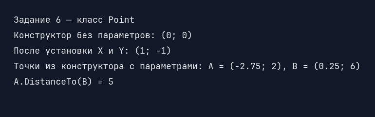

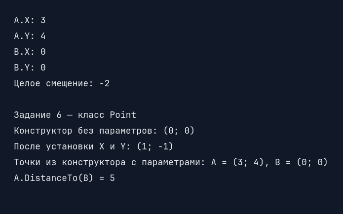

**Задание 7. Операторы Point.** Готовый пример использует смещение `3`. Ручная проверка использует те же точки, что в задании 6, и смещение `-2`: координата `X` становится равной `1`, а исходная точка остаётся `(3; 4)`.

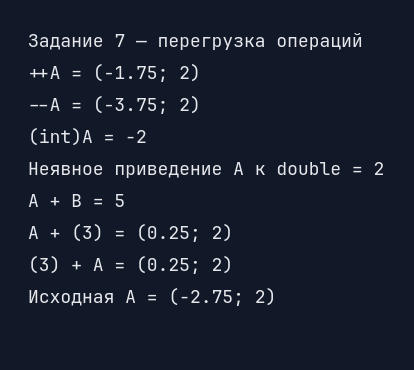

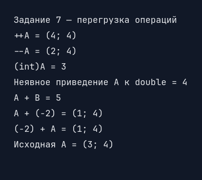

## Запуск

```text
dotnet build CSharpLabs.sln
dotnet run --project CSharpLabs/CSharpLabs.csproj
dotnet run --project Lab4.Points/Lab4.Points.csproj
```

В основном приложении выберите `4`, затем `1`–`5` для ввода данных или `6` для показа примеров. В проекте `Lab4.Points` выберите `1` для ввода координат или `2` для показа всех операций на готовых данных.
