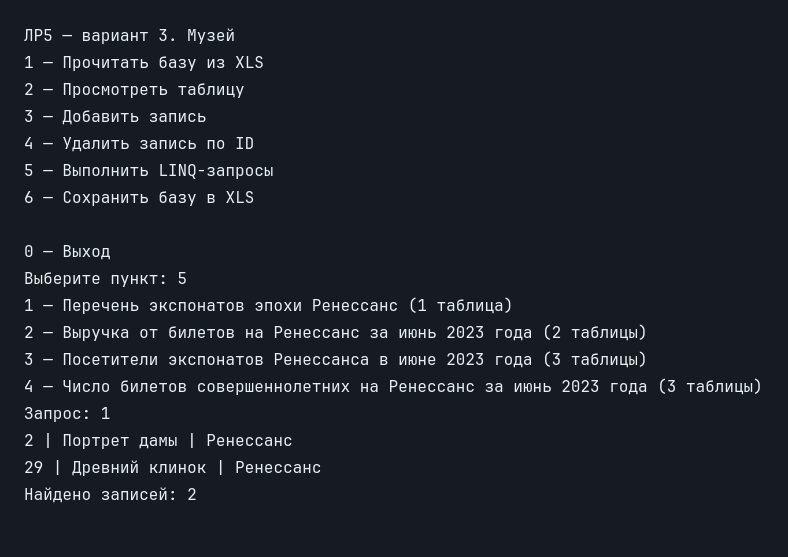
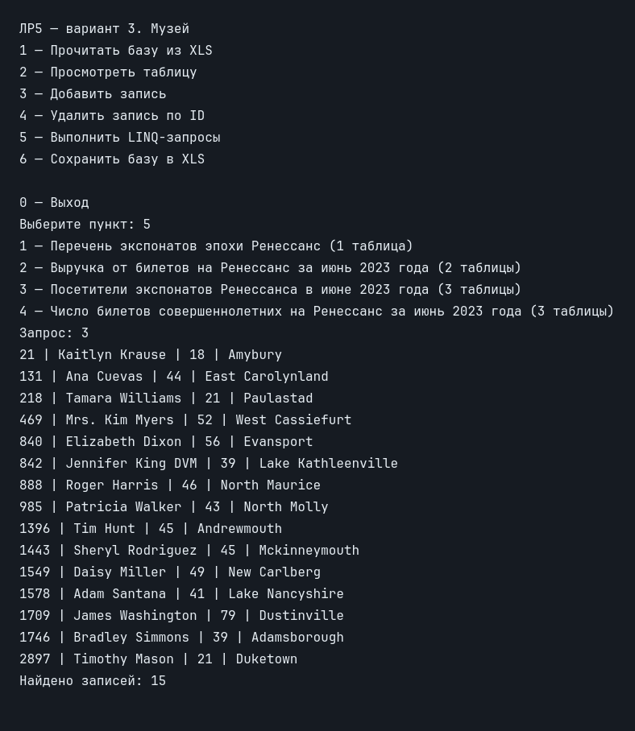
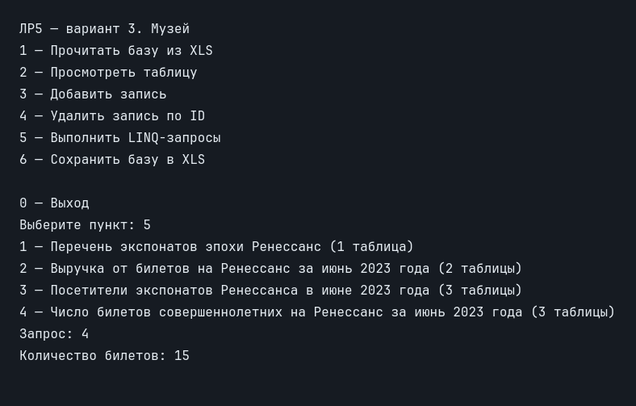

# Лабораторная работа №5, вариант 3

Тема работы — LINQ-запросы. База данных «Музей» содержит сведения об экспонатах, посетителях и билетах. [Условие](lab5_csharp.pdf).

## Запуск приложения

```powershell
dotnet run --project Lab5.ExcelDataReader/Lab5.ExcelDataReader.csproj
```

При запуске загружается прилагаемый файл `LR5-var3.xls`. Другой XLS-файл можно передать аргументом командной строки или выбрать через меню.

| Пункт меню | Возможность |
| --- | --- |
| 1 | Загрузка базы из выбранного XLS-файла |
| 2 | Просмотр любой таблицы страницами по 20 записей с сортировкой по ID |
| 3 | Добавление экспоната, посетителя или билета |
| 4 | Удаление записи выбранной таблицы по ID |
| 5 | Выбор одного из четырёх LINQ-запросов |
| 6 | Сохранение трёх таблиц в XLS-файл |
| 0 | Завершение работы |

## Классы

Модели расположены в папке `Lab5.ExcelDataReader/Models` и пространстве имён `Lab5.ExcelLibrary.Models`.

| Класс | Свойства | Назначение |
| --- | --- | --- |
| `Exhibit` | `int Id`, `string Name`, `string Era` | Экспонат и его историческая эпоха |
| `Visitor` | `int Id`, `string Name`, `int Age`, `string City` | Посетитель, его возраст и город проживания |
| `Ticket` | `int Id`, `int ExhibitId`, `int VisitorId`, `DateTime Date`, `decimal Price` | Билет со ссылками на экспонат и посетителя, датой посещения и стоимостью |

Конструкторы проверяют входные данные и задают значения автосвойств только для чтения. Перегруженный метод `ToString()` возвращает значения свойств в виде строки для просмотра таблиц. Стоимость представлена типом `decimal`, дата — `DateTime`. Внешние ключи `ExhibitId` и `VisitorId` ссылаются на `Id` соответствующих таблиц.

`MuseumContext` хранит три списка объектов и методы загрузки, добавления, удаления и сохранения записей. Связи билетов проверяются при загрузке и добавлении; экспонат или посетитель со связанными билетами не удаляется. Вспомогательный класс `MuseumQueries` содержит четыре LINQ-запроса. Чтение и запись XLS выполняются через NPOI.

## Запросы

Запросы сформулированы по варианту 3. Два запроса возвращают перечень, два — одно числовое значение. Период июня задаётся от 01.06.2023 включительно до 01.07.2023 исключительно. Совершеннолетним считается посетитель с возрастом от 18 лет, указанным в базе.

Запросы 2–4 используют один закрытый метод, который отбирает июньские билеты и соединяет их с экспонатами Ренессанса.

```csharp
private static readonly DateTime JuneStart = new DateTime(2023, 6, 1);
private static readonly DateTime JulyStart = new DateTime(2023, 7, 1);

private static IEnumerable<Ticket> JuneRenaissanceTickets(MuseumContext museum)
{
    IEnumerable<Ticket> juneTickets = museum.Tickets
        .Where(ticket => ticket.Date >= JuneStart && ticket.Date < JulyStart);
    IEnumerable<Exhibit> exhibits = museum.Exhibits.Where(IsRenaissance);

    return juneTickets.Join(exhibits,
        ticket => ticket.ExhibitId,
        exhibit => exhibit.Id,
        (ticket, exhibit) => ticket);
}

private static bool IsRenaissance(Exhibit exhibit)
{
    return exhibit.Era.Equals("Ренессанс", StringComparison.OrdinalIgnoreCase);
}
```

### 1. Одна таблица, перечень

Вывести все экспонаты эпохи Ренессанс, упорядоченные по ID.

```csharp
public static List<Exhibit> RenaissanceExhibits(MuseumContext museum)
{
    return museum.Exhibits
        .Where(IsRenaissance)
        .OrderBy(exhibit => exhibit.Id)
        .ToList();
}
```

Результат исходной базы состоит из двух записей.

```text
2 | Портрет дамы | Ренессанс
29 | Древний клинок | Ренессанс
```

### 2. Две таблицы, одно значение

Определить суммарную выручку от продажи билетов на экспонаты эпохи Ренессанс за июнь 2023 года. Это пример из условия.

```csharp
public static decimal RenaissanceRevenue(MuseumContext museum)
{
    return JuneRenaissanceTickets(museum).Sum(ticket => ticket.Price);
}
```

Результат равен **10499 руб.** и совпадает с ответом в условии.

### 3. Три таблицы, перечень

Вывести без повторов посетителей, купивших в июне 2023 года билеты на экспонаты эпохи Ренессанс. Результат упорядочить по ID посетителя.

```csharp
public static List<Visitor> RenaissanceVisitors(MuseumContext museum)
{
    return JuneRenaissanceTickets(museum)
        .Join(
            museum.Visitors,
            ticket => ticket.VisitorId,
            visitor => visitor.Id,
            (ticket, visitor) => visitor)
        .DistinctBy(visitor => visitor.Id)
        .OrderBy(visitor => visitor.Id)
        .ToList();
}
```

Результат содержит **15 посетителей**. `DistinctBy(visitor => visitor.Id)` оставляет каждого посетителя один раз, даже если он купил несколько билетов.

### 4. Три таблицы, одно значение

Подсчитать число билетов совершеннолетних посетителей на экспонаты эпохи Ренессанс за июнь 2023 года.

```csharp
public static int AdultTicketCount(MuseumContext museum)
{
    IEnumerable<Visitor> adults = museum.Visitors.Where(visitor => visitor.Age >= 18);

    return JuneRenaissanceTickets(museum)
        .Join(
            adults,
            ticket => ticket.VisitorId,
            visitor => visitor.Id,
            (ticket, visitor) => ticket)
        .Count();
}
```

Результат равен **15 билетам**. Повторные посещения учитываются отдельными билетами.

## Примеры работы программы

Примеры выполнения четырёх запросов на прилагаемой базе:

**Запрос 1.** Найдены два экспоната Ренессанса.



**Запрос 2.** Суммарная выручка равна 10499 руб.


**Запрос 3.** Найдены 15 посетителей без повторов.



**Запрос 4.** Подсчитано 15 билетов совершеннолетних посетителей.



В примере пользователь добавляет экспонат и посетителя с ID `4001`, а затем билет с ID `4001`, связывающий их. Дата билета — `15.06.2023`, цена — `100.50` руб.

| Действие в меню | Результат |
| --- | --- |
| Добавить три записи через пункт `3` | Три сообщения «Запись добавлена» |
| Выполнить запрос `5 → 2` | Выручка составляет `10599.50` руб. |
| Попытаться удалить экспонат `4001` через пункт `4` | Удаление отклонено, потому что на экспонат есть билет |
| Сохранить через пункт `6` и заново открыть файл | Выручка остаётся равной `10599.50` руб. |
| Удалить билет, посетителя и экспонат, затем сохранить | Выручка составляет `10499.00` руб. |

## Ограничения данных и сохранение

Загрузка проверяет названия листов, заголовки столбцов, типы значений, уникальность ID и наличие связанных объектов для каждого билета. Полностью пустые строки пропускаются. При ошибке повторной загрузки предыдущая база остаётся доступной.

ID должны быть положительными целыми числами. Пустые названия, имена и города отклоняются. Возраст допускается от 0 до 150 лет, дата — от 01.01.1900, цена — от 0 до 1 000 000 000 рублей с точностью до копеек. Для билета требуется существующий посетитель и экспонат. Удаление посетителя или экспоната со связанными билетами отклоняется, пока эти билеты не удалены.

Программа отслеживает несохранённые изменения. Перед выходом или заменой изменённой базы запрашивается подтверждение. Сохранение создаёт XLS-книгу с тремя таблицами, заголовками и форматом дат. Сначала файл записывается во временный файл в целевой папке, затем заменяет выбранный файл. При ошибке записи существующий файл сохраняется. Перед заменой существующего файла интерфейс запрашивает подтверждение.

Если таблицы пусты, запросы возвращают пустые перечни и нулевые значения суммы и количества.
